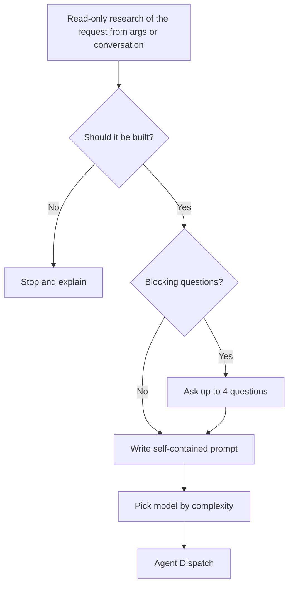
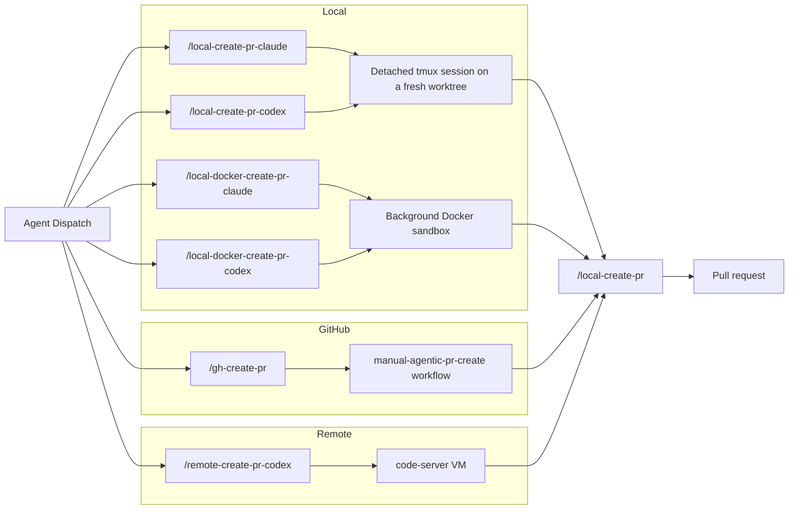
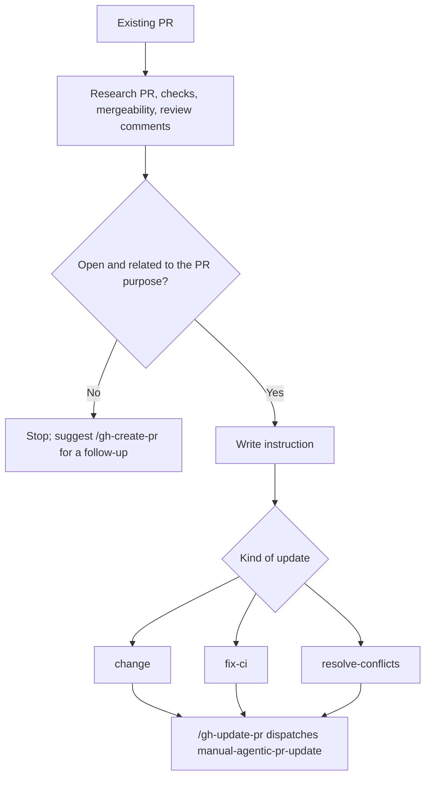

# Agent Context — docs/human-context/

Diagrams and overviews for people; agents never read them for rules.

## Table of Contents

- [Scope](#scope)
- [Upkeep](#upkeep)
- [Agentic Workflow](#agentic-workflow)
  - [Pre-Dispatch Steps](#pre-dispatch-steps)
  - [Agent Dispatch Options](#agent-dispatch-options)
  - [Update Variant](#update-variant)

## Scope

- Each `##` section below the upkeep rules mirrors a canonical doc one level up ([Agentic Workflow](#agentic-workflow) mirrors [agent-support.md](../agent-support.md)). The canonical doc and the skills in `setup/dotfiles/agent-skills/` win on any conflict; never add a rule here that they lack.
- Prefer Mermaid diagrams with minimal prose; link to the canonical section instead of restating it.

## Upkeep

- When a canonical doc, an agent skill, a command in [agent-commands.md](../agent-commands.md) or an `agentic-`/`manual-`/`cron-` workflow changes how a flow runs, update the matching diagram in the same change.
- Verify node names against the skill or workflow they cite (dispatch commands, workflow file names, runner mediums). Only skills that dispatch appear as dispatch nodes; `local-create-pr` and `local-update-pr` are the implementation skills agents run after dispatch.
- Rebuild the ToC when headings change.

## Agentic Workflow

Diagrams of how the agentic create/update commands work. Canonical rules live in [agent-support.md](../agent-support.md); the command list is in [agent-commands.md](../agent-commands.md).

### Pre-Dispatch Steps

### Agent Dispatch Options

### Update Variant

