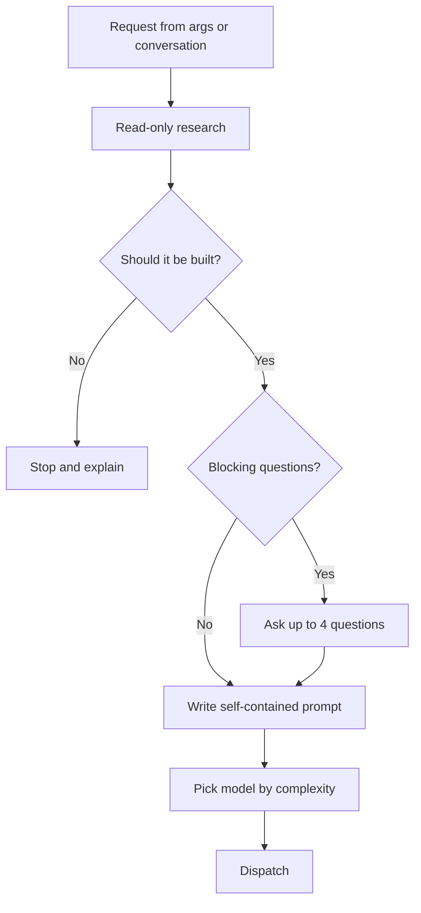
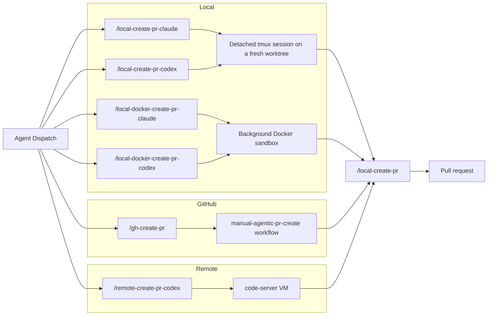
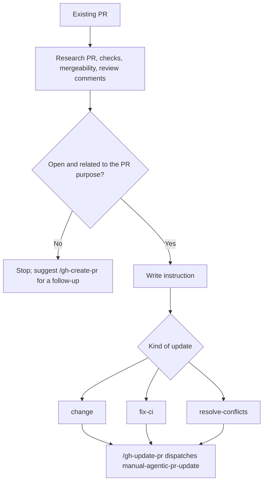

# Agent Support (Human Overview)

Diagrams of how the agentic create/update commands work. Canonical rules live in [agent-support.md](../agent-support.md); the command list is in [agent-commands.md](../agent-commands.md).

## Table of Contents

- [Shared Front End](#shared-front-end)
- [Dispatch Mediums](#dispatch-mediums)
- [Update Variant](#update-variant)

## Shared Front End

## Dispatch Mediums

## Update Variant

