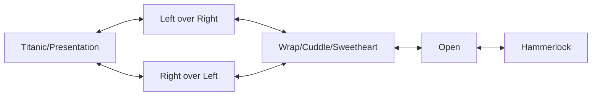

# Social Dancing

## Contents

- [Guidelines](#guidelines)
  - [Good Dancing](#good-dancing)
  - [Embellishments](#embellishments)
  - [Hand Changes](#hand-changes)
- [Personal Notes](#personal-notes)
- [Social](#social)
  - [Dancing With Someone New](#dancing-with-someone-new)
  - [Social Exercises](#social-exercises)
- [Moves](#moves)
  - [Body Moves](#body-moves)
  - [Hand Moves](#hand-moves)
  - [Power Entries](#power-entries)
- [Types of Turns](#types-of-turns)
- [Dips](#dips)
- [Positions](#positions)
- [Position Transitions](#position-transitions)
- [Variations](#variations)
- [Types of Social Dancing](#types-of-social-dancing)

## Guidelines

### Good Dancing

- Being on time.
- Not feeling rushed between steps.
- Listening to the music.
- Musicality.
- Having a lead to follow connection, i.e. good frame and eye engagement.

### Embellishments

- Styling

### Hand Changes

- Avoid abrupt hand changes, i.e. just switching hands.

## Personal Notes

- [Personal Dance Notes](./personal-dance-notes.md)

## Social

### Dancing With Someone New

- Start with shines to observe style/level and get feel of music

### Social Exercises

- 1 hand
- shoulders only
- waist only
- palms only
- eyes closed
- [STUCK? Create New Salsa Moves With These Tricks](https://www.youtube.com/watch?v=CXQQ99_hq5k)

## Moves

### Body Moves

| Move | Description |
| --- | --- |
| Body roll | Continuous undulation from chest to hips, the solo cousin of the wave. |
| Chest pop | Quick isolated push or release of the chest on an accent. |
| Dips | Lead lowers the follow backward or sideways while supporting them; see [Dips](#dips). |
| Hip isolation | Hip circles or figure-eights moving separately from the feet and upper body. |
| Shoulder shimmy | Fast alternating shoulder shake, often used on shines. |
| Waves | Fluid ripple through the body or arms, travelling from one point to the next; done solo or in hold. |

### Hand Moves

| Move | Description |
| --- | --- |
| Combs | Hand slides through the partner's hair, usually after a turn or as a styling flourish. |
| Flicks | Quick, sharp whips of the hand, used as accents on a beat. |
| Palm flourish | Open-palm gestures and wrist rolls used as a styling accent. |
| Tracing | Dragging a hand lightly along the partner's arm, shoulder or back as a connection-based accent. |

### Power Entries

| Entry |
| --- |
| Around the world |
| Crossbody push |
| Wrap exit |

## Types of Turns

- Hook turns

## Dips

| Name | Description |
| --- | --- |
| Back dip | Follow leans straight back over the lead's supporting arm while the lead lunges forward; the most common dip. |
| Crossbody dip | Ends a crossbody lead by catching the follow as they arrive and lowering them to the side along the slot. |
| Hammock | Follow reclines deeply backward, held across the lead's forearm and thigh, and is rocked or pulled back up. |
| Side dip | Lead steps out to the side and lowers the follow sideways, supporting the follow's back and hand. |
| Spin-and-catch dip | Follow finishes a turn into the lead's arm, and the lead uses that momentum to lower them into a dip. |
| Sweetheart dip | From wrap/sweetheart, lead folds the follow backward over the lead's arm while keeping the wrapped arms across the front. |

## Positions

| Name | Description |
| --- | --- |
| Breakback | Both partners step back away from each other on a hand connection, building stretch to launch the next move. |
| Closed | Lead's right hand on the follow's back, follow's left hand on the lead's shoulder, free hands joined. |
| Crossbody | Lead opens the slot and the follow travels across to the opposite side. |
| Hammerlock | One or both of the follow's arms wrapped behind their own back and held by the lead. |
| Handshake hold | Right-to-right hand connection like a handshake; entry point for hook turns and wraps. |
| Left over right | Both hands joined with the left arm crossed over the right; sets the unwinding direction. |
| Open | Facing each other at arm's length, connected only through the hands; the default frame for turn patterns. |
| Right over left | Both hands joined with the right arm crossed over the left; the mirror of the above. |
| Shadow | Follow directly in front of or beside the lead, both facing the same direction and moving together. |
| Titanic/Presentation | Follow in front of the lead with both arms opened wide out to the sides, or extended out to one side to showcase them. |
| Wrap/Cuddle/Sweetheart | Follow in front of the lead, both facing the same way, arms wrapped across the follow's front. |

## Position Transitions

- Open is the hub — sweetheart unwinds back out to open, and open winds into hammerlock by taking one arm behind the follow's back.
- Titanic is the wide-armed midpoint: crossing the arms from there enters either left over right or right over left, and continuing the cross closes into the wrap.
- Every edge runs both ways, so any entry also reads as an exit by reversing the arm path.

## Variations

- [Hammerlock](https://www.youtube.com/watch?v=ayP9HYRqhoE)
- [Yoyo](https://www.youtube.com/watch?v=1h4e7bN6jB4&t=55s)
- [Titanic/Presentation](https://www.youtube.com/watch?v=W0J03PmRms4)

## Types of Social Dancing

- [Salsa](./salsa.md)
- [Bachata](./bachata.md)
- [West Coast Swing](./west-coast-swing.md)
