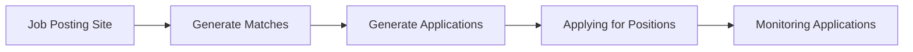

# Job Hunt Workflow

## Table of Contents

- [Diagram](#diagram)
- [Stages](#stages)

## Diagram

## Stages

| Stage | Goal |
| --- | --- |
| Job Posting Site | Find postings on a job board and collect the ones worth a closer look. |
| Generate Matches | Score each posting against your skills and summarize it, so the best fits come first. |
| Generate Applications | Tailor a resume and cover letter to each posting you chose. |
| Applying for Positions | Submit each application and record that you did. |
| Monitoring Applications | Track replies and move each application through interview, offer or rejection. |
