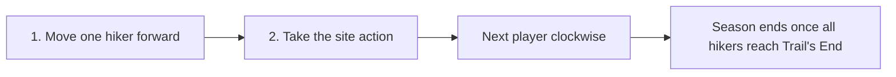
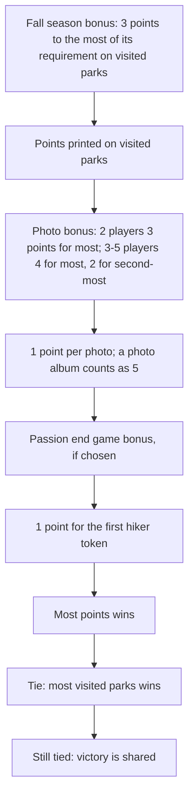

# Parks

## Table of Contents

- [Goal](#goal)
- [Limitations](#limitations)
- [Setup](#setup)
- [On Your Turn](#on-your-turn)
  - [1. Move a Hiker](#1-move-a-hiker)
  - [2. Take the Site Action](#2-take-the-site-action)
  - [Free Action: Campfire](#free-action-campfire)
- [Trail Sites](#trail-sites)
- [Resources](#resources)
- [Parks](#parks)
- [Photos](#photos)
- [Shutterbug](#shutterbug)
- [Canteens](#canteens)
- [Gear](#gear)
- [Passion Cards](#passion-cards)
- [Trail's End](#trails-end)
- [Season End](#season-end)
- [Game End](#game-end)
  - [Scoring](#scoring)
- [Quick Tips](#quick-tips)
- [References](#references)

## Goal

Hike the trail over 3 seasons, spending resources to visit parks and take photos, to finish with the most points.

## Limitations

| Limit | Value | Notes |
| --- | --- | --- |
| Backpack | 12 resources | Discard down to 12 at the end of your turn |
| Canteen row | 2 canteen tokens | Each row activates once per season when you add a water; one token is enough |
| Gear benefit | Once per turn | Gear is active while hiking and between seasons |
| Hikers | 2 per player | Each season both hikers walk the trail once |
| Movement | Forward only | Left to right, any number of spaces; no backtracking |
| Player count | 1–5 | 2 players may add Ranger Teddy and solo uses him; those modes are not covered here |
| Resource supply | Finite | If the resource is not available you do not gain it |
| Seasons | 3 | Spring, Summer, Fall |
| Site occupancy | 1 hiker per site | Extinguish your campfire to share; Trail's End takes any number |
| Visiting a site | Must be able to act | You cannot stop at a site whose action you cannot take |

## Setup

- Place the board and the two resource trays, then shuffle the 8 trail site tiles onto the trail sites.
- Place a weather token (alternating Sun and Water) on each site from the 2nd onward.
- Roll the trail die and place the Shutterbug under the matching trail site; keep the Shutterbug Badge beside the board.
- Draw 1 spring, 1 summer and 1 fall season bonus tile and set them face up.
- Reveal 3 park cards (parks display), 3 gear cards (gear market) and 3 canteens (canteen display).
- Place the photo bonus tile on the side matching the player count.
- Each player takes a pair of hikers at the trailhead, the matching player board, a random canteen in the top-left spot, a campfire and 1 passion card.
- The campfire starts lit with 4–5 players and unlit with 1–3.
- The player who most recently visited a national park takes the first hiker token.

## On Your Turn

The first-hiker player starts each season. Each player then moves one of their 2 hikers any number of spaces forward and takes the action of the site they stop on. Turns pass clockwise, and you may move either hiker. A season ends once every hiker has reached Trail's End.

### 1. Move a Hiker

- Choose either of your 2 hikers; you are not forced to move the one furthest back.
- Move to any open site ahead, skipping as many as you like; skipped sites are left for the others.
- The site must be one whose action you can actually take.
- A hiker at Trail's End stays there for the rest of the season.
- When only one player has hikers left on the trail, they must move both hikers straight to Trail's End and take a Trail's End action for each.

### 2. Take the Site Action

- Take the action of the site you stopped on.
- If you are the first hiker to reach a site with a weather token, also take that token (Sun or Water) into your backpack, in either order with the action.
- Gear benefits are gained in any order after you take the site action; you may gain several in one turn, each only once.

### Free Action: Campfire

- To stop on an occupied site, extinguish your campfire by flipping it face down; this also lets you share with your own hiker.
- An extinguished campfire limits you to unoccupied sites until it is relit at season end.

## Trail Sites

| Site | Action |
| --- | --- |
| Canteen / Photo | Gain a canteen, or trade 1 resource for a photo |
| Forest | Gain 1 forest |
| Gear | Purchase gear |
| Mountain | Gain 1 mountain |
| Parks | Reserve a park, or visit parks |
| Sun | Gain 2 sun |
| Trail Die | Roll the trail die and gain the benefit |
| Water | Gain 2 water |
| Wildlife trade | Trade 1 resource for a wildlife |

## Resources

| Resource | Notes | Special Use |
| --- | --- | --- |
| 🌲 Forest | Common park cost |  |
| ⛰️ Mountain | Common park cost |  |
| ☀️ Sun | Common park cost | Pays for gear: sun equal to a market card's cost, or 2 sun to draw the top card; also a weather token |
| 💧 Water | Common park cost | Fills canteen rows for their benefits, or stays in the backpack; also a weather token |
| 🦌 Wildlife | Wild; substitutes for any other resource to visit parks, buy gear or take photos |  |

## Parks

- Parks are the main source of points.
- Reserve: take 1 park from the display or the top of the deck into your reserved parks area. Only you can visit your reserved parks.
- Visit: pay the park's resources from your backpack to place it in your visited parks area. You may visit as many parks as you can afford from the display and your reserve.
- A wildlife in a park's cost must be paid with a wildlife.
- Instant action parks (lightning bolt) trigger when visited: gain resources, a canteen, the Shutterbug Badge or a trail die roll.
- Refill the display only after your turn has completely ended.

## Photos

- Trade 1 resource for a photo token worth 1 point; place it above your player board.
- Trade 5 photos in for a photo album worth 5 points.
- The player with the most photos at game end earns the photo bonus.

## Shutterbug

- The Shutterbug token sits under a trail site chosen by the trail die roll; it is rerolled every season end.
- Landing on that site earns the Shutterbug Badge on top of the site's action. If another player already holds it, take it from them.
- The Shutterbug stays on the trail all season, so each player can earn the badge; some instant action parks also grant it.
- With the badge, once per turn you may spend 1 extra resource to take a second photo whenever you take a photo.

## Canteens

- You have 3 canteen rows, each holding 2 canteen tokens with space for a water between them.
- Gain a canteen by taking one from the display or the top of the stack and placing it in an empty canteen spot; refill the display if you took from it.
- Whenever you gain a water, choose to add it to your backpack or to a canteen row to gain that row's benefits.
- Water kept in your backpack cannot fill a canteen later.
- Each row activates with water once per season, even with only one token in it; adding a canteen to a row that already has water gives no benefit that season.

## Gear

- Purchase gear by spending sun equal to a gear market card's cost, or 2 sun to draw the top gear card.
- Place purchased gear below your player board; slide the market right and refill from the deck.
- Gear is usable immediately, and its benefit triggers once per turn.
- At season end the rightmost gear market card is discarded and the rest slide right.

## Passion Cards

- Each passion card has an objective on one side; start with it face up and complete it by taking specific actions on your turn.
- Once complete, flip it and choose one reward by tucking the card under your player board:
  - **Gear effect:** a unique gear ability for the rest of the game.
  - **End game bonus:** a unique scoring bonus at game end.
- Completing a passion mid-turn may benefit another action that same turn.
- After your first play you may deal 2 passions to each player and keep 1.

| Passion | Objective | Gear effect | End game bonus |
| --- | --- | --- | --- |
| Adventure | Visit 2 parks with instant actions | Visiting an instant action park also rolls the trail die | 1 point per instant action park visited |
| Birdwatching | Visit 2 parks with at least 1 sun | Parks cost 1 fewer sun | 1 point per visited park with a sun |
| Botany | Visit 3 forests on parks | Gaining a forest may be a wildlife | 1 point per 2 forests on visited parks |
| Collecting | Purchase 2 gear cards | All gear purchases are free | 1 point per gear card purchased |
| Forestry | Visit 3 parks with at least 1 forest | Parks cost 1 fewer forest | 1 point per visited park with a forest |
| Kayaking | Visit 2 parks with at least 1 water | Parks cost 1 fewer water | 1 point per visited park with a water |
| Mountaineering | Visit 3 parks with at least 1 mountain | Parks cost 1 fewer mountain | 1 point per visited park with a mountain |
| Rock Climbing | Visit 3 mountains on parks | Gaining a mountain may be a wildlife | 1 point per 2 mountains on visited parks |
| Swimming | Visit 3 water on parks | Filling a canteen also rolls the trail die | 1 point per 2 water on visited parks |
| Wildlife | Spend a wildlife to take a photo | Trade a wildlife for 2 photos instead | 1 point per 3 photos taken |

## Trail's End

- When a hiker reaches Trail's End, choose 1 of 3 actions there: visit or reserve a park, take a photo, or purchase gear.
- The first player to take each action places their hiker on the smaller space and gains a bonus: the first hiker token for the park action, a wildlife for the photo, or a sun for the gear.
- Any number of hikers may occupy these spaces.
- Once both your hikers are at Trail's End, you are done for the season.

## Season End

1. **Season scoring:** award the season bonus, then flip the season tile (after spring and summer).
   - Spring: most of the pictured resource in your backpack earns the pictured bonus for free, such as the top gear card.
   - Summer: most of the pictured resource in your backpack rolls the trail die twice and gains the results.
   - Fall: most of the pictured requirement on visited parks earns 3 points at game end.
   - Ties all gain the benefit; if nobody meets the requirement, nobody gains it.
2. **Player steps:** empty canteens of water back to the tray, relight your campfire, return hikers to the trailhead.
3. **Trail steps:** reshuffle and replace trail sites, add new weather, roll the trail die and place the Shutterbug, discard the rightmost gear market card and refill.

## Game End

The game ends after the 3rd season, when all hikers have reached Trail's End; go straight to scoring.

### Scoring

## Quick Tips

- Hold a hiker back to stop on a site another player is racing for, burning your campfire only when it pays off.
- Take weather tokens by arriving first at a site; they are free resources.
- Buy gear early; it pays off every remaining turn.
- Pick which passion bonus (gear or end game) fits your plan before flipping.
- Chasing the Shutterbug Badge enables a second photo each turn.

## References

- [Parks 2nd Edition rules](https://gamers-hq.de/media/pdf/18/a3/a1/Parks-2nd-Edition-1-1-Rules_Online_compressed.pdf)
