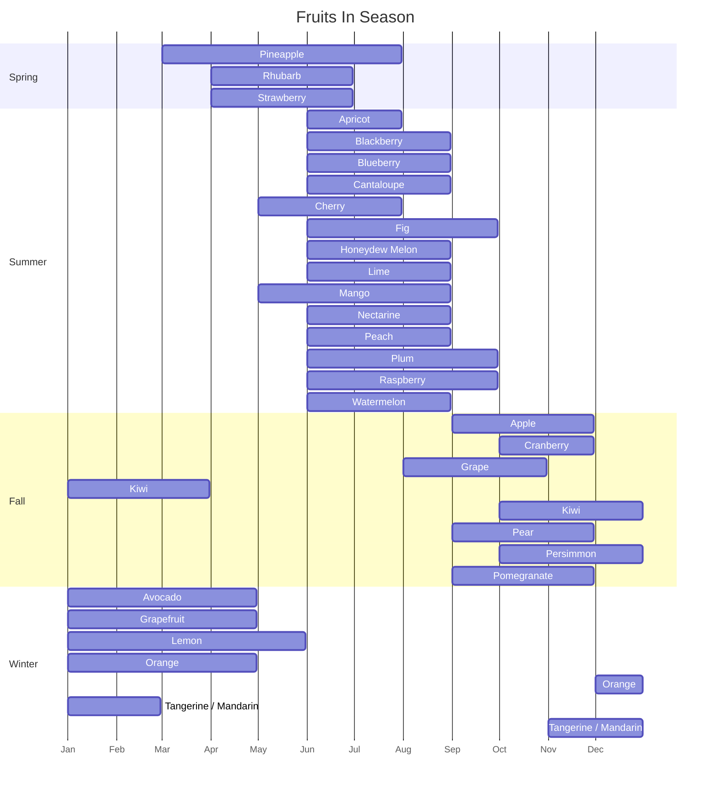

# Fruits

Peak season for a temperate Northern Hemisphere climate (e.g. the continental US); actual availability varies by region and is wider wherever imports or greenhouse growing are common. The hearth app reads the Seasonal Timeline below to build its In Season card, so the gantt format must stay parseable.

## Table of Contents

- [Seasonality](#seasonality)
  - [Seasonal Timeline](#seasonal-timeline)

## Seasonality

### Seasonal Timeline

Grouped by each fruit's first-listed season; a bar split in two means the peak window wraps across the new year (e.g. Orange peaks Dec–Apr, drawn as Jan–Apr plus Dec). Dates use an arbitrary year — only the month position matters.

