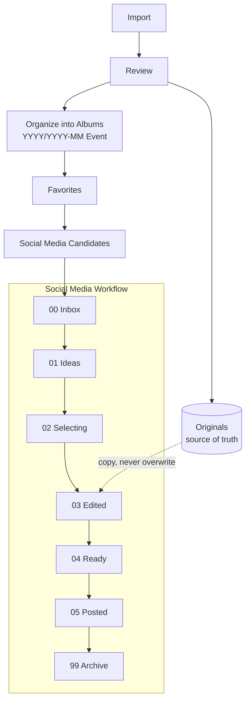

# Photo Organization System

## Table of Contents

- [1. Media Workflow](#1-media-workflow)
- [2. Personal Photo Library](#2-personal-photo-library)
- [3. Social Media Organization](#3-social-media-organization)
- [4. Important Distinctions](#4-important-distinctions)
- [5. Recommended Approach](#5-recommended-approach)

## 1. Media Workflow

Applies to both photos and videos.



## 2. Personal Photo Library

Organize by **year → date/event/location**.

```text
Photos/
├── 2026/
│   ├── 2026-04 Japan Trip
│   ├── 2026-08 Copenhagen
│   └── 2026-09 Malmö Skate
├── 2025/
└── 2024/
```

- Keep original photos as the source of truth.
- Use albums/tags for people, hobbies, travel, food, etc.
- Use favorites to mark personally meaningful photos.
- Avoid excessive folders; organize by event when practical.

## 3. Social Media Organization

Organize around **posts and publishing status**, not individual photos.

```text
Social/
├── 00 Inbox
├── 01 Ideas
├── 02 Selecting
├── 03 Edited
├── 04 Ready
├── 05 Posted
└── 99 Archive
```

Each post gets its own folder:

```text
Social/
└── 2026/
    └── 2026-09-19 Malmö Skate
        ├── 01.jpg
        ├── 02.jpg
        ├── 03.jpg
        └── caption.txt
```

## 4. Important Distinctions

| Term | Meaning |
| --- | --- |
| Albums | Use for events and meaningful collections, not every possible category. |
| Favorites | Photos you personally want to remember. |
| Originals | Preserve separately; don't overwrite them with edits. |
| Social media candidates | Photos you might want to publish. |
| Social media exports | Store edited versions with their corresponding post, cropped per platform when needed. |

## 5. Recommended Approach

- Use Apple Photos for your main personal library, albums, favorites, and search.
- Use a separate social media folder or lightweight database to track post ideas and publishing status.
- Organize travel photos by trip, adding city/day subfolders only when volume justifies it.
- Keep the system simple and avoid unnecessary duplication.

**Core principle:** Organize personal photos around memories and events; organize social media photos around posts and workflow.
