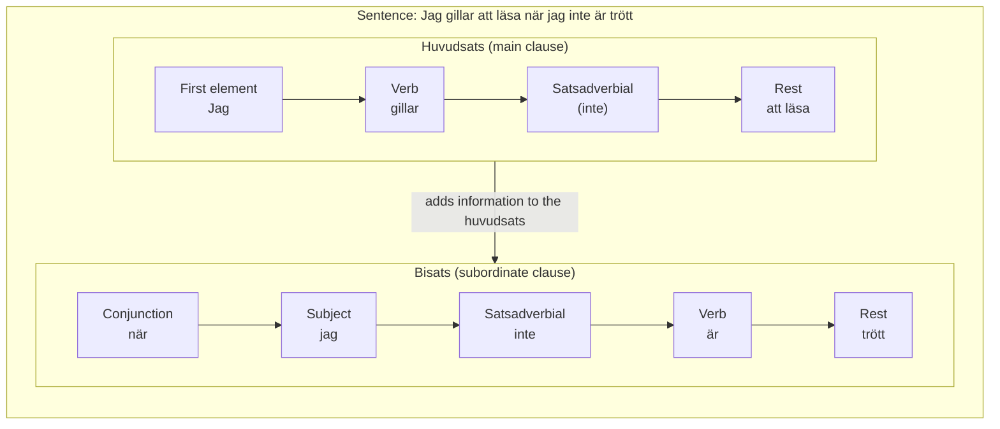
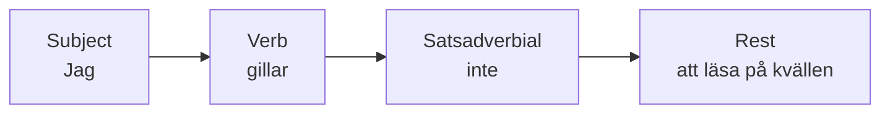
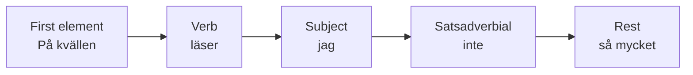
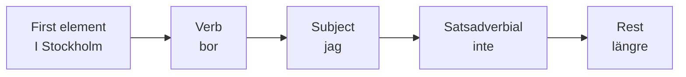
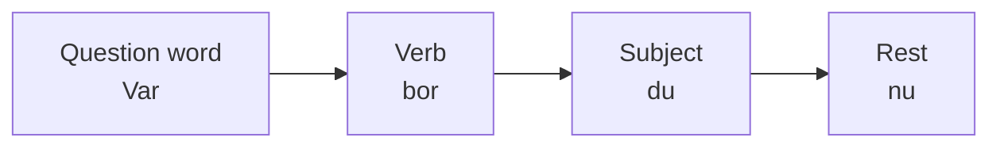
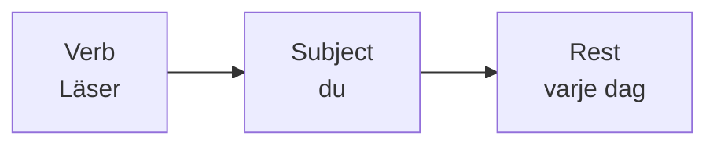

# Swedish Grammar

## Table of Contents

- [Terms](#terms)
- [Huvudsats and Bisats Structure](#huvudsats-and-bisats-structure)
- [Rak ordföljd (Straight Word Order)](#rak-ordföljd-straight-word-order)
- [Omvänd ordföljd (Inverted Word Order)](#omvänd-ordföljd-inverted-word-order)
  - [Time first](#time-first)
  - [Location first](#location-first)
  - [Question with a question word](#question-with-a-question-word)
  - [Yes/no question](#yesno-question)
- [Possessive](#possessive)

## Terms

| **Term** | **Description** | **Example** |
| --- | --- | --- |
| **Huvudsats (Main Clause)** | A main clause that can stand alone as a complete sentence. Contains a subject and a verb. | "Jag gillar att läsa." |
| **Bisats(Subordinate Clause)** | A subordinate clause that cannot stand alone and depends on the main clause. Often begins with a conjunction like "att," "om," or "för att." | "Jag gillar att läsa när jag har tid." |
| **[Satsadverbial (Sentence Adverbial)](./swedish-verbs/swedish-satsadverbial.md)** | A word that modifies the entire sentence, often expressing negation, probability, or emphasis. It appears **before the verb in a bisats** and **after the first element in a huvudsats**. | "Jag gillar **inte** att läsa på kvällen." (Main clause)   "Jag gillar att läsa när jag **inte** är trött." (Subordinate clause) |
| **[Hjälpverb (Auxiliary Verb)](./swedish-verbs/swedish-auxiliary-verbs.md)** | An auxiliary verb that combines with a main verb to form different tenses, moods, or aspects. | "Jag **ska** läsa en bok." (Future)   "Jag **har** läst den boken." (Perfect)   "Jag **kan** läsa svenska." (Ability) |
| **Huvudverb (Main Verb)** | The main action or state in the sentence. It carries the primary meaning and can often stand alone without an auxiliary verb. | "Jag **läser** en bok."   "Hon **springer** varje morgon."   "Vi **tänker** på dig." |

## Huvudsats and Bisats Structure

A huvudsats stands alone; a bisats depends on it and is introduced by a conjunction. Both can sit in one sentence: _Jag gillar att läsa när jag inte är trött._

## Rak ordföljd (Straight Word Order)

The subject comes first, then the verb in position 2, then the rest. Used in a huvudsats that starts with the subject.

## Omvänd ordföljd (Inverted Word Order)

Something other than the subject comes first (often time or place), so the verb stays in position 2 and the subject moves after it.

### Time first

_In the evening I don't read so much._

### Location first

_I don't live in Stockholm anymore._

### Question with a question word

_Where do you live now?_

### Yes/no question

_Do you read every day?_

## Possessive

[subject]s [noun]
