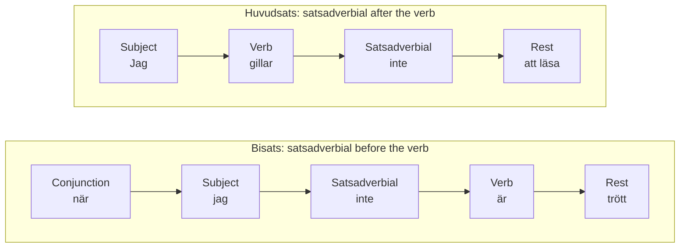

# Swedish Satsadverbial (Sentence Adverbial)

A word that modifies the entire sentence, often expressing negation, probability, or emphasis. It appears **after the first element in a huvudsats** and **before the verb in a bisats**.

| **English** | **Swedish** |
| --- | --- |
| **Negation & Certainty** |  |
| not | inte |
| hardly | knappast |
| absolutely | absolut |
| definitely | definitivt |
| **Probability & Doubt** |  |
| maybe | kanske |
| probably | nog |
| likely | troligen |
| presumably | förmodligen |
| possibly | möjligen |
| possibly (alternative) | eventuellt |
| certainly | säkert |
| **Emphasis & Modality** |  |
| as you know | ju |
| surely | väl |
| actually | faktiskt |
| really | egentligen |
| possibly (alternative) | möjligen |
| anyway | ändå |
| in any case | i alla fall |
| **Time & Frequency** |  |
| always | alltid |
| never | aldrig |
| often | ofta |
| rarely | sällan |
| sometimes | ibland |
| already | redan |
| soon | snart |
| still | fortfarande |
| finally | till sist |
| **Attitude & Evaluation** |  |
| unfortunately | tyvärr |
| fortunately | lyckligtvis |
| moreover | dessutom |
| at least | åtminstone |
| only | bara |
| gladly / willingly | gärna |
| rather | hellre |
| preferably / most of all | helst |
