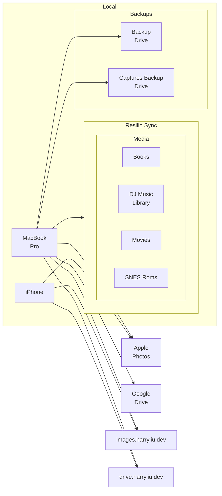
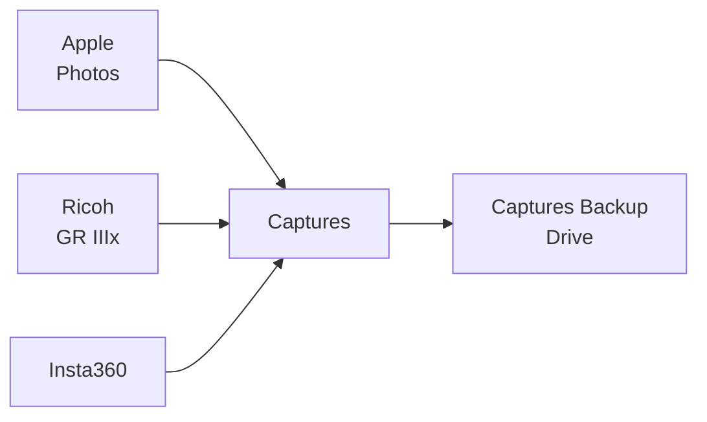

# Content Management Audit

## Table of Contents

- [3-2-1 Rule](#3-2-1-rule)
- [Storage Locations](#storage-locations)
  - [Cloud](#cloud)
  - [Local](#local)
- [Digital Assets](#digital-assets)
- [Captures Flow](#captures-flow)
- [Immich Local Storage](#immich-local-storage)

## 3-2-1 Rule

| Requirement | Meaning | Audit Column |
| --- | --- | --- |
| 3 copies | 1 primary + 2 backups | Primary Location, Backup Drive, Cloud Location |
| 2 storage types | e.g. local drive + cloud | Primary Location, Cloud Location |
| 1 off-site copy | Cloud or physically separate location | Cloud Location |

## Storage Locations

### Cloud

| Location | Description | Badge |
| --- | --- | --- |
| Apple Photos | Mainly for iPhone content |  |
| drive.harryliu.dev | Self-hosted Seafile file sync on an AWS EC2 VM behind Cloudflare Access |  |
| Gitea | Self-hosted Git on an OCI VM behind Cloudflare Access; hosts the journal repo |  |
| GitHub | Hosts the vigilant-broccoli repo |  |
| Google Drive | Google content only: Docs, Sheets, Slides, etc. |  |
| images.harryliu.dev | Self-hosted Immich photo and video library on an AWS EC2 VM behind Cloudflare Access |  |

### Local

| Location | Description | Badge |
| --- | --- | --- |
| Backup Drive | External drive mounted as `Backup`; holds the Media Library: Books, DJ Music Library, Movies and SNES Roms |  |
| Captures Backup Drive | External drive for Captures: images and videos |  |
| iPhone |  |  |
| MacBook Pro |  |  |

## Digital Assets

| Asset | Primary Location | Backup Drive | Cloud Location |
| --- | --- | --- | --- |
| Apple Photos |   |  |  |
| Books |  |  |  |
| Captures |  |  |  |
| DJ Music Library |  |  |  |
| Docs |  |  |  |
| Journal |  |  |  |
| Movies |  |  |  |
| Presentations |  |  |  |
| Profile Images and Phone Wallpapers |  |  |  |
| SNES Roms |  |  |  |
| vigilant-broccoli |  |  |  |

## Captures Flow

## Immich Local Storage

| Data | Location | Notes |
| --- | --- | --- |
| Database dumps | `~/resilio-sync/backup/immich-db-backups/` | Immich's scheduled Database Backup job; bind-mounted over `/data/backups` and synced by Resilio Sync |
| ML model cache | `data/model-cache` beside the compose file | Re-downloaded if lost |
| Originals | `~/resilio-sync/shared/immich/upload/` | Uploaded photos and videos, plus `.xmp` sidecars |
| Postgres data | `data/pgdata` beside the compose file | Not synced; restore from a database dump |
| Thumbnails and transcodes | `~/resilio-sync/shared/immich/thumbs/` and `encoded-video/` | Regenerable |
| Upload root | `~/resilio-sync/shared/immich/` | Mounted as `/data` in the server container |
