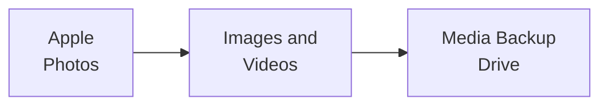

# Content Management Audit

## Table of Contents

- [3-2-1 Rule](#3-2-1-rule)
- [Storage Locations](#storage-locations)
- [Digital Assets](#digital-assets)
- [Media Flow](#media-flow)

## 3-2-1 Rule

| Requirement | Meaning | Audit Column |
| --- | --- | --- |
| 3 copies | 1 primary + 2 backups | Primary Location, Backup Drive, Cloud Location |
| 2 storage types | e.g. local drive + cloud | Primary Location, Cloud Location |
| 1 off-site copy | Cloud or physically separate location | Cloud Location |

## Storage Locations

| Location | Description | Badge |
| --- | --- | --- |
| Apple Photos | Mainly for iPhone content |  |
| Backup Drive | External drive mounted as `Backup`; holds Books, DJ Music Library, Images, Movies and SNES Roms |  |
| drive.harryliu.dev | Self-hosted Seafile file sync on an AWS EC2 VM behind Cloudflare Access |  |
| Gitea | Self-hosted Git on an OCI VM behind Cloudflare Access; hosts the journal repo |  |
| GitHub | Hosts the vigilant-broccoli repo |  |
| Google Drive | Needed for high availability documents |  |
| immich.harryliu.dev | Self-hosted Immich photo and video library on an AWS EC2 VM behind Cloudflare Access |  |
| Local Machine |  |  |
| Media Backup Drive | Backup drive for image and video content |  |
| Mobile Device |  |  |
| Seafile | Self-hosted file storage and synchronization, served at drive.harryliu.dev |  |

## Digital Assets

| Asset | Primary Location | Backup Drive | Cloud Location |
| --- | --- | --- | --- |
| Apple Photos |   |  |  |
| Books |  |  |   |
| DJ Music Library |  |  |   |
| Docs |  |  |  |
| Images and Videos |  |  |  |
| Journal |  |  |  |
| Movies |  |  |  |
| Presentations |  |  |  |
| Profile Images and Phone Wallpapers |  |  |  |
| SNES Roms |  |  |   |
| vigilant-broccoli |  |  |  |

## Media Flow

