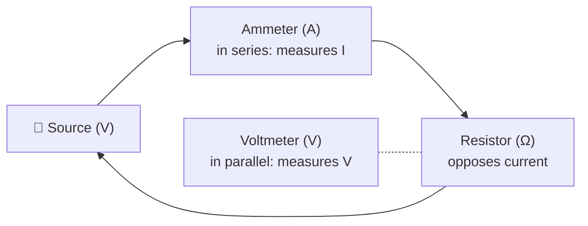

# Electricity

## Table of Contents

- [Ohm's Law](#ohms-law)

## Ohm's Law

**V = I × R**, so **I = V / R** and **R = V / I**.

| Quantity | Unit | Connect | Water analogy |
| --- | --- | --- | --- |
| Current (I) | Ampere (A) | In series, breaking the circuit | Flow rate through the pipe |
| Resistance (R) | Ohm (Ω) | Across the part, out of circuit | Pipe narrowness |
| Voltage (V) | Volt (V) | In parallel, across the part | Water pressure |
