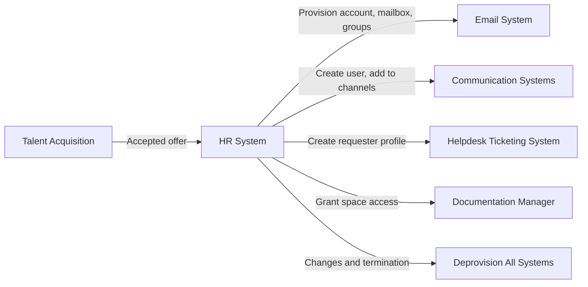

# Organization Infrastructure

## Table of Contents

- [Systems](#systems)
- [Employee Data Flow](#employee-data-flow)

## Systems

| System | Description | Example solutions |
| :-- | :-- | :-- |
| Communication systems | Real-time chat, channels, video calls and announcements for day-to-day collaboration between people and teams. | Slack, Microsoft Teams, Google Chat, Zoom, Discord, Mattermost |
| Documentation manager | A searchable knowledge base for handbooks, runbooks, policies and design docs, with permissions and version history. | Confluence, Notion, Google Drive/Docs, SharePoint, GitBook, Outline |
| Email system | Hosted mailboxes, calendars and company-domain addresses, plus spam filtering and shared or group inboxes. | Google Workspace (Gmail), Microsoft 365 (Outlook), Fastmail, Zoho Mail, Proton Mail |
| Helpdesk ticketing system | Intake, tracking and resolution of internal IT or customer requests, with queues, SLAs, assignment and reporting. | Jira Service Management, Zendesk, Freshdesk, ServiceNow, Zammad, Help Scout |
| HR system | System of record for employees: profiles, contracts, payroll, time off, performance reviews and the onboarding and offboarding lifecycle (HRIS). | Workday, BambooHR, HiBob, Personio, Rippling, Gusto, Deel |
| Talent acquisition | Applicant tracking from job posting through sourcing, interview scheduling and scorecards to offer and hand-off into the HR system (ATS). | Greenhouse, Lever, Ashby, Workable, SmartRecruiters, Teamtailor |

## Employee Data Flow

