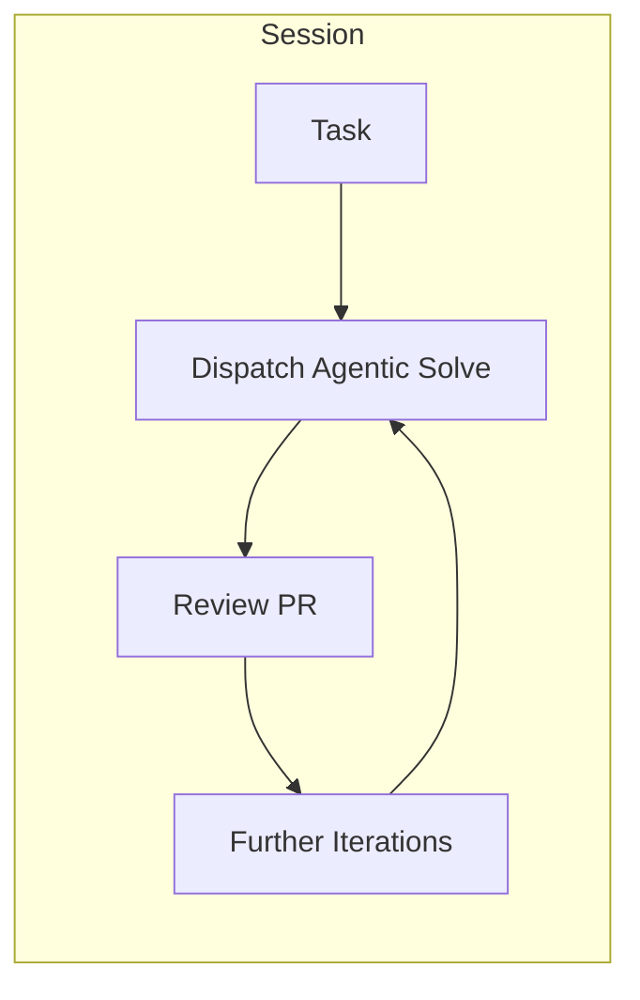

# Agentic Workflow Orchestration

## Table of Contents

- [Diagram](#diagram)
- [Stages](#stages)

## Diagram

## Stages

| Stage | Goal |
| --- | --- |
| Task | Research the request in the session and settle open questions before handing it off. |
| Dispatch Agentic Solve | Start an agent with a self-contained prompt that implements the task and opens a PR. |
| Review PR | Read the diff and CI results, and decide whether it is ready to merge. |
| Further Iterations | Send review feedback or CI fixes back to an agent to update the same PR. |
