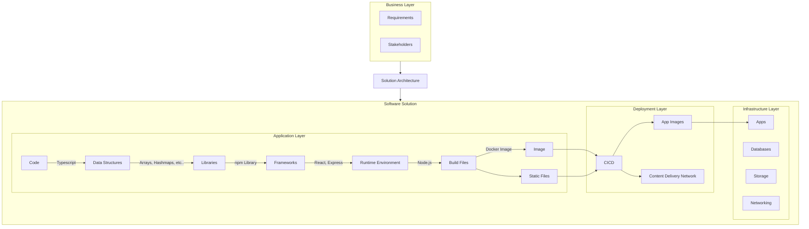
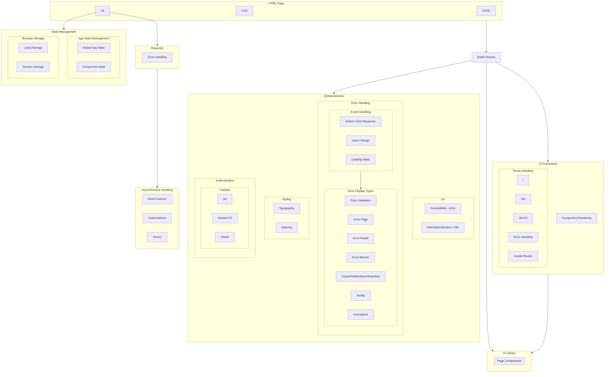
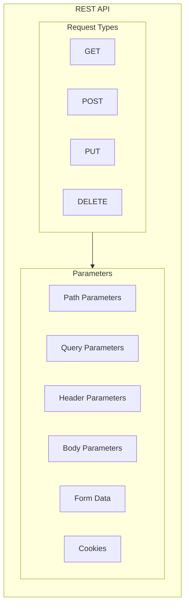

# Software Breakdown

## Table of Contents

- [Diagrams](#diagrams)
  - [Software Solution Tree](#software-solution-tree)
  - [Infrastructure](#infrastructure)
  - [Frontend Design](#frontend-design)
  - [Backend](#backend)
- [Services](#services)
- [Environments](#environments)
- [Common Structures](#common-structures)
- [Software Choices](#software-choices)
- [Embellishments](#embellishments)

## Diagrams

### Software Solution Tree

```text
📦 Software Solution
└── 🤖 Agentic Context
    └── 🏗️ Infrastructure Layer
        ├── 🗄️ Databases
        ├── Networking
        ├── Storage
        └── Apps
            └── 🚀 Deployment Layer
                └── CICD
                    ├── App Images
                    │   └── 🌿 Version Control
                    │       ├── Branching
                    │       ├── Code Review Process
                    │       └── 🧩 Application Layer
                    │           ├── ⚙️ Backend
                    │           │   └── REST API
                    │           │       ├── Parameters
                    │           │       └── Request Types
                    │           └── 🎨 Frontend
                    │               └── HTML Page
                    │                   ├── CSS
                    │                   ├── HTML
                    │                   └── JavaScript
                    └── 🌐 Content Delivery Network
```

### Infrastructure



### Frontend Design



### Backend



## Services

| Service | Description |
| --- | --- |
| Cache | In-memory store for fast reads and rate limiting, such as Redis or Memcached. |
| Database | Stores and queries the application's persistent data. |
| Message Queue / Event Bus | Passes work and events between services asynchronously, such as RabbitMQ, SQS or Kafka. |
| Monitoring | Collects metrics, logs and alerts to show how the system is running, such as Grafana or Datadog. |
| Secret Manager | Stores credentials and API keys securely and serves them to apps and CI at runtime. |

## Environments

| Environment | Purpose | Deploys on | Data |
| --- | --- | --- | --- |
| Dev / Feature branches | Where changes are built and tried in isolation, one environment per branch or locally. | Pushes to a feature branch | Fake or seeded, never real user data |
| Staging | Production-like environment for final checks, integration tests and stakeholder review before release. | Merge to the main branch | Production-like, anonymized or copied |
| Production | The live environment real users depend on. | Promotion from a verified staging build | Real user data |

## Common Structures

| Structure | Description |
| --- | --- |
| Auth Management | Verifies who users are and what they may access, via sessions, tokens, OAuth and SSO. |
| Log Management | Collects, stores and searches logs from every service in one place. |
| User Management | Handles user accounts, sign-up and sign-in, roles and permissions. |

## Software Choices

| Options | Reasoning |
| --- | --- |
| Cloud vs On-prem | Cloud for elasticity, low upfront cost and less operations work; on-prem for data control, compliance or predictable high steady load. |
| Headless vs Traditional CMS | Headless when content must reach several frontends or you want frontend freedom; traditional when one site and fast setup matter most. |
| Manual vs Automated Deployment | Manual for one-off or throwaway setups; automated for repeatability, speed and fewer human errors. |
| One to Many vs Many to Many | One to many when each child belongs to a single parent (foreign key); many to many when both sides can have several, using a join table. |
| ORM vs Raw SQL | ORM for productivity, type safety and portability on typical CRUD; raw SQL for complex queries, tuning and full control over performance. |
| SQL vs NoSQL | SQL for structured, relational data needing transactions and joins; NoSQL for flexible schemas, massive scale or simple key-based access. |

## Embellishments

| Embellishment | Description |
| --- | --- |
| Analytics | Tracks user behavior to understand how the product is used. |
| SEO | Search engine optimization: makes pages easier for search engines to find and rank. |
