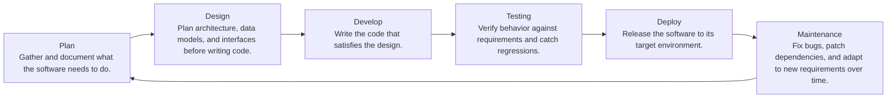

# Software Lifecycle

## Table of Contents

- [Cycle](#cycle)
  - [Develop](#develop)
  - [Deploy](#deploy)
  - [Maintenance](#maintenance)

## Cycle

### Develop

- Integrations

### Deploy

- Image publish
- Package publish

### Maintenance

- App audit
  - Security
  - Performance
  - Scalability
- Documentation audit
- Prune codebase for dead code/documentation
- Comment alignment
  - Aligned trailing comments
