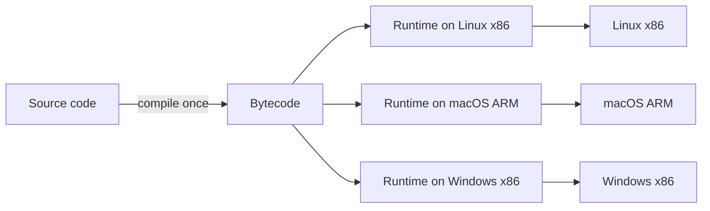
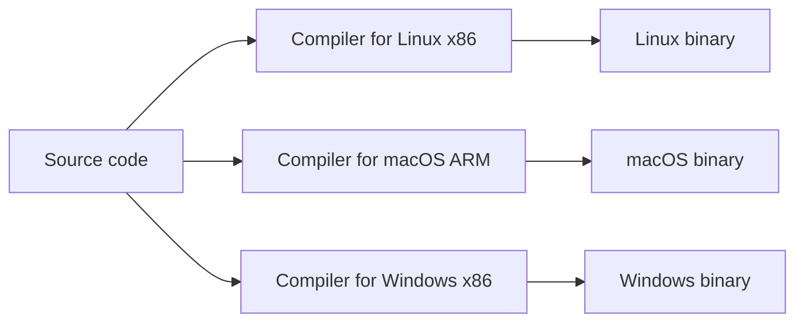
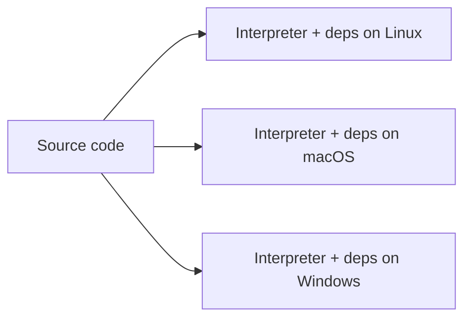
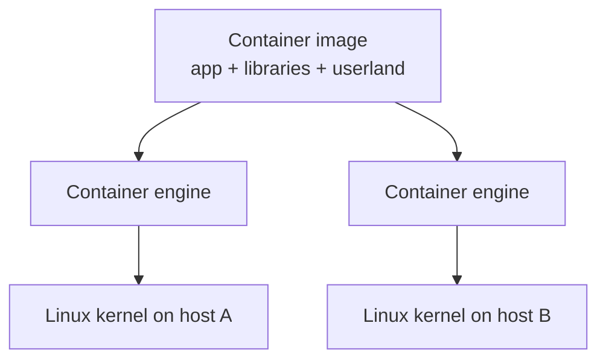
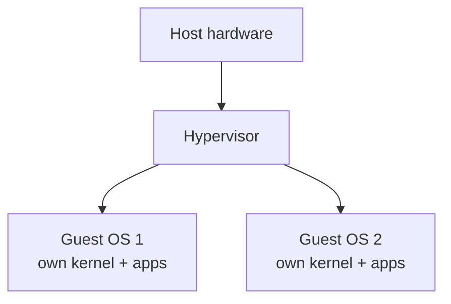
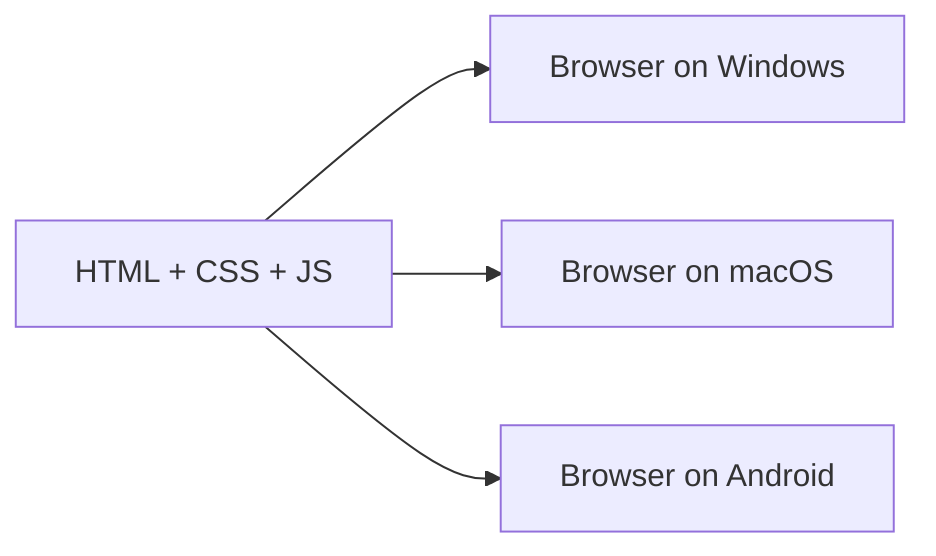

# Software Portability

## Table of Contents

- [Portability Options](#portability-options)
- [Runtimes vs VMs](#runtimes-vs-vms)
- [Diagrams](#diagrams)
  - [Portable Bytecode](#portable-bytecode)
  - [Native Recompilation](#native-recompilation)
  - [Interpreted Source](#interpreted-source)
  - [Containers](#containers)
  - [Virtual Machines](#virtual-machines)
  - [Web Platform](#web-platform)

## Portability Options

| Option | What travels | What the target must provide | Examples |
| --- | --- | --- | --- |
| Containers | App, libraries and userland | Linux kernel and a container engine | Docker, Podman |
| Interpreted source | Source code | Matching interpreter and dependencies | Python, Node.js, Ruby |
| Native recompilation | Source code | A compiler toolchain per OS and CPU | C, C++, Rust, Go |
| Portable bytecode | Compiled intermediate code | A runtime for the bytecode | Java (JVM), .NET (CLR), WASM |
| Virtual machine images | Whole OS, apps and config | A hypervisor on a matching CPU | VMware, VirtualBox, cloud AMIs |
| Web platform | HTML, CSS and JavaScript | A browser | Web apps, PWAs |

## Runtimes vs VMs

| Aspect | Language runtime (JVM, CLR, Node.js) | Virtual machine (hypervisor) |
| --- | --- | --- |
| Abstracts | The language and its standard library | Hardware: CPU, memory, disk and NICs |
| Runs | Bytecode or source inside one process | A full guest OS with its own kernel |
| Portability | Across OSes and CPUs the runtime supports | Across hosts with the same CPU architecture |
| Startup | Milliseconds to seconds | Seconds to minutes |
| Footprint | Megabytes | Gigabytes |
| Isolation | Process-level; sandboxing is up to the runtime | Strong, enforced by the hypervisor |
| Typical use | Running one application | Running many OSes or tenants on one machine |

The JVM is called a "virtual machine" but is a process VM: it emulates an abstract instruction set, not a computer. A system VM emulates hardware. Containers sit between the two: they share the host kernel, so they are lighter than VMs but only portable across the same kernel type.

## Diagrams

### Portable Bytecode

Languages: Java, Kotlin, Scala (JVM); C#, F#, VB.NET (CLR); Rust, C, C++, Go and others via WebAssembly.

Compile once, and each platform's runtime absorbs the OS and CPU differences.

### Native Recompilation

Languages: C, C++, Rust, Go, Swift, Zig.

The same source is compiled separately for each target.

### Interpreted Source

Languages: Python, Ruby, PHP, Perl, JavaScript (Node.js), Lua.

The source ships as is and each target needs a matching interpreter and dependencies.

### Containers

Languages: any; the image bundles the runtime or binary, so the language does not matter.

The app and its userland travel together, but all hosts share the same kernel type.

### Virtual Machines

Languages: any; the whole OS image travels, so the language does not matter.

A hypervisor emulates hardware, so each guest runs a full OS with its own kernel.

### Web Platform

Languages: JavaScript, TypeScript (transpiled), HTML, CSS; WebAssembly targets such as Rust, C and C++.

The browser is the runtime, so one page runs on any OS that has one.

