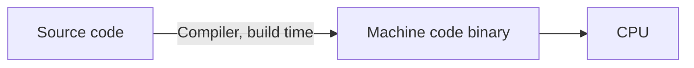
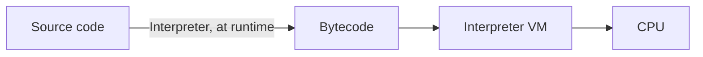
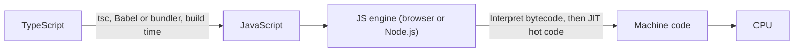

# Software Languages

## Table of Contents

- [Software Execution](#software-execution)
  - [Execution Paths](#execution-paths)
    - [Native Compiled](#native-compiled)
    - [Compiled to a Virtual Machine](#compiled-to-a-virtual-machine)
    - [Interpreted](#interpreted)
    - [Transpiled to JavaScript](#transpiled-to-javascript)
  - [Machine Code vs Bytecode](#machine-code-vs-bytecode)
  - [Compiled vs Transpiled vs Interpreted](#compiled-vs-transpiled-vs-interpreted)
- [Programming Paradigms](#programming-paradigms)
  - [Imperative vs Declarative](#imperative-vs-declarative)
  - [Procedural vs Functional vs Object-Oriented](#procedural-vs-functional-vs-object-oriented)
  - [Static vs Dynamic Typing](#static-vs-dynamic-typing)
- [Language Comparison Table](#language-comparison-table)
- [Language Conversion Table](#language-conversion-table)
- [Framework Conversion Table](#framework-conversion-table)
- [References](#references)

## Software Execution

### Execution Paths

#### Native Compiled

C, C++, Rust, Go, Swift.

#### Compiled to a Virtual Machine

Java, Kotlin, Scala (JVM); C# (.NET CLR); Elixir (BEAM).

#### Interpreted

Python, Ruby, PHP. Bash skips the bytecode step and executes each line directly.

#### Transpiled to JavaScript

TypeScript; plain JavaScript skips the transpile step.

### Machine Code vs Bytecode

| Aspect | Machine Code | Bytecode |
| :-- | :-- | :-- |
| Runs on | CPU directly | Virtual machine (interpreted/JIT) |
| Portability | One OS and CPU per build | Any platform with the VM |
| Speed | Fastest | Near native once JIT compiled |
| Examples | C, C++, Rust, Go, Swift | Java, Kotlin, C#, Elixir, Python |

### Compiled vs Transpiled vs Interpreted

| Aspect | Compiled | Transpiled | Interpreted |
| :-- | :-- | :-- | :-- |
| Translation | To machine code or bytecode | To another source language | None, run directly |
| When | Build time | Build time | Runtime |
| Speed | Fastest | Same as target language | Slowest (JIT helps) |
| Errors | Caught at build | Caught at build | Caught when run |
| Examples | C, Rust, Go; Java, C# bytecode | TypeScript, Sass | Python, Ruby, Bash |

## Programming Paradigms

### Imperative vs Declarative

| Aspect | Imperative | Declarative |
| :-- | :-- | :-- |
| Core idea | Spell out the steps that change state | Describe the result, not the steps |
| Control | Programmer controls the execution order | Engine decides how to produce the result |
| Styles | Procedural, object-oriented | Functional, logic |
| Examples | C, Java, Python | SQL, HTML/CSS, Terraform |
| Code (names of adults) | `const names = [];` `for (const u of users) {` `  if (u.age >= 18) names.push(u.name);` `}` | `SELECT name FROM users WHERE age >= 18;` |

### Procedural vs Functional vs Object-Oriented

| Aspect | Procedural | Functional | Object-Oriented |
| :-- | :-- | :-- | :-- |
| Core idea | Ordered steps grouped into routines | Pure functions composed together | Objects bundling data with behaviour |
| State | Shared, mutable | Immutable, passed between functions | Encapsulated inside objects |
| Code reuse | Calling shared functions | Higher-order functions and composition | Inheritance and polymorphism |
| Side effects | Common | Avoided or isolated | Common, contained by encapsulation |
| Code (sum of even squares) | `int total = 0;` `for (int i = 0; i < n; i++) {` `  if (nums[i] % 2 == 0) total += nums[i] * nums[i];` `}` | `nums` `  .filter(x => x % 2 === 0)` `  .map(x => x * x)` `  .reduce((a, b) => a + b, 0)` | `class Nums {` `  constructor(values) { this.values = values; }` `  sumEvenSquares() {` `    return this.values` `      .filter(x => x % 2 === 0)` `      .reduce((a, x) => a + x * x, 0);` `  }` `}` `new Nums(nums).sumEvenSquares()` |

### Static vs Dynamic Typing

| Aspect | Static | Dynamic |
| :-- | :-- | :-- |
| Core idea | Types are checked at compile time | Types are checked at runtime |
| Variable types | Fixed once declared or inferred | A variable can hold values of any type over its lifetime |
| Type errors | Caught before the program runs | Surface only when the offending line executes |
| Annotations | Declared, or inferred (Go, Kotlin, Rust, Swift, TypeScript) | Usually none; optional hints (Python type hints) |
| Tooling | Precise autocomplete, refactoring and navigation | Weaker static analysis; relies on tests and runtime checks |
| Speed | Faster; the compiler can optimize with known types | Slower; type checks and dispatch happen at runtime |
| Flexibility | More upfront ceremony; generics needed for reuse | Quick prototyping and duck typing |
| Examples | C, Go, Java, Kotlin, Rust, Swift, TypeScript | JavaScript, Lua, Perl, PHP, Python, Ruby |
| Code (add) | `function add(a: number, b: number): number {` `  return a + b;` `}` `add(1, "2"); // compile error` | `def add(a, b):` `    return a + b` `add(1, "2")  # TypeError at runtime` |

## Language Comparison Table

| Language | Primary Use Cases | Type / Paradigm | Compiled or Interpreted | Memory Management | Notable Features | Edge over competitors |
| --- | --- | --- | --- | --- | --- | --- |
| **C** | Operating systems, embedded systems, hardware-level dev | Procedural, low-level | Compiled | Manual | Small runtime, close to hardware | Smallest runtime, runs on nearly any hardware, and its ABI is the universal foreign-function interface. |
| **C#** | Desktop, game dev (Unity), enterprise | Object-oriented, component-based | Compiled to .NET IL | Garbage-collected | Part of .NET ecosystem, LINQ | Excellent tooling and LINQ, and the main scripting language of Unity; adds properties and value types beyond Java. |
| **C++** | Systems programming, game engines, performance-critical apps | Multi-paradigm (procedural, OOP) | Compiled | Manual (RAII) | Low-level control, high performance | Zero-cost abstractions with richer features than C, plus decades of mature libraries versus Rust. |
| **Dart** | Cross-platform apps (Flutter) | Object-oriented | JIT + AOT compiled | Garbage-collected | Designed for UI dev | Flutter's hot reload and one codebase for mobile, web, and desktop, with JIT in development and AOT in release. |
| **Elixir** | Scalable, concurrent web services | Functional (Erlang VM) | Compiled to BEAM bytecode | Garbage-collected | Fault tolerance, concurrency | BEAM concurrency and supervisor-based fault tolerance with friendlier syntax than Erlang. |
| **Go (Golang)** | Cloud services, networking, concurrent apps | Compiled, statically typed | Compiled | Garbage-collected | Fast builds, goroutines, simplicity | Simple syntax, fast builds, built-in concurrency, and static binaries, easier for services than Java or C++. |
| **Haskell** | Functional programming, research | Purely functional | Compiled | Garbage-collected | Immutability, type inference | Enforced purity and strong type inference separate side effects more strictly than Scala or OCaml. |
| **Java** | Enterprise apps, Android, backend systems | Object-oriented, class-based | Compiled to JVM bytecode | Garbage-collected | Platform-independent (JVM), strong typing | Mature JVM ecosystem, strong backward compatibility, and a huge enterprise talent pool. |
| **JavaScript** | Web front-end, back-end (Node.js), mobile apps | High-level, event-driven, functional + OOP | Interpreted (JIT in browsers) | Garbage-collected | Runs in browsers, asynchronous I/O | Only language native to browsers, so one language spans front end and back end. |
| **Kotlin** | Android, backend, multiplatform | Statically typed, modern JVM language | Compiled to JVM or native | Garbage-collected | Interoperable with Java | Null safety and concise syntax over Java with full interop; Google's preferred Android language. |
| **Lua** | Game scripting, embedded systems | Lightweight, procedural | Interpreted | Garbage-collected | Embeddable, fast | Tiny embeddable runtime with a simple C API, easier to embed than Python or JavaScript. |
| **MATLAB** | Engineering, simulation, numeric computing | Procedural + functional | Interpreted | Managed | Built-in matrix ops, visualization | Polished vendor-supported toolboxes and Simulink, versus free NumPy or Octave. |
| **Perl** | Text processing, sysadmin scripts | Scripting, multi-paradigm | Interpreted | Garbage-collected | Powerful regex, flexible syntax | Built-in regex and text munging; largely superseded by Python and Ruby today. |
| **PHP** | Web backend scripting | High-level, interpreted | Interpreted | Garbage-collected | Deep web integration, simple deployment | Cheapest and most widely available web hosting, with a per-request model and WordPress/Laravel ecosystems. |
| **Python** | Data science, automation, web dev, AI | High-level, interpreted, multi-paradigm (OOP, functional) | Interpreted | Garbage-collected | Huge standard library, readable syntax | Easiest to learn among major languages, with unmatched data-science and AI libraries versus R or Java. |
| **R** | Statistics, data visualization, data analysis | High-level, functional | Interpreted | Garbage-collected | Statistical modeling, visualization | Deeper statistical packages (CRAN) and ggplot2 visualization than Python for statistics. |
| **Ruby** | Web apps, automation, scripting | High-level, interpreted, OOP | Interpreted | Garbage-collected | Simple syntax, convention over configuration | Optimized for developer happiness; Rails speeds up CRUD web apps and prototypes. |
| **Rust** | Systems programming, secure and concurrent apps | Compiled, statically typed | Compiled | Ownership model (no GC) | Memory safety without GC | Memory safety without a garbage collector, which C and C++ cannot guarantee at compile time. |
| **Scala** | Big data, functional JVM apps | Functional + OOP | Compiled to JVM | Garbage-collected | Expressive, integrates with Java | Richer type system and functional features than Java on the JVM; the language of Apache Spark. |
| **Shell (Bash/Zsh)** | Automation, system scripts | Scripting, procedural | Interpreted | N/A | Command-line integration | Glues existing command-line tools with pipes and is available on virtually every Unix system. |
| **SQL** | Database queries, data manipulation | Declarative | Interpreted (DB engine) | Managed by DB | Set-based operations | Declarative standard across relational databases; the optimizer chooses the execution plan. |
| **Swift** | iOS/macOS apps | Compiled, statically typed | Compiled | Automatic Reference Counting (ARC) | Safe, fast, modern syntax | First-class on Apple platforms, safer and more concise than Objective-C. |
| **TypeScript** | Web + server development, large-scale JS apps | Superset of JavaScript with static typing | Transpiled to JS | Garbage-collected | Type safety, tooling support | Adds static types to the full JavaScript ecosystem, catching errors plain JavaScript misses. |

## Language Conversion Table

| Python | TypeScript | Go | Java |
| :-- | :-- | :-- | :-- |
| `for i, num in enumerate(nums)` | `for (const [i, num] of nums.entries())` | `for i, num := range nums { ... }` | `for (int i = 0; i < nums.length; i++) { int num = nums[i]; ... }` |
| `hmap.values()` | `hmap.values()` | `for _, value := range hmap { ... }` (unordered iteration) | `hmap.values()` (`Map<K, V>`) |
| `hmap = {}` | `const hmap = {}` | `hmap := make(map[string]int)` (choose key/value types) | `Map<String, Integer> hmap = new HashMap<>();` (import `java.util.*`) |
| `len(arr)` | `arr.length` | `len(arr)` | `arr.length` (array), `list.size()` (`List`) |
| `arr.pop()` | `arr.pop()` | `x := arr[len(arr)-1]; arr = arr[:len(arr)-1]` (nonempty slice) | `list.remove(list.size() - 1)` (`List`), `stack.pop()` (`Deque`) |
| `arr.append(x)` | `arr.push(x)` | `arr = append(arr, x)` | `list.add(x)` |
| `if, elif, else` | `if, else if, else` | `if, else if, else` | `if, else if, else` |
| `not` | `!` | `!` | `!` |
| `or` | `\|\|` | `\|\|` | `\|\|` |
| `==` | `===` | `==` | `==` (primitives), `a.equals(b)` (objects) |
| `!=` | `!==` | `!=` | `!=` (primitives), `!a.equals(b)` (objects) |
| `float("inf")` | `Infinity` | `math.Inf(1)` (import `math`) | `Double.POSITIVE_INFINITY` |
| `float("-inf")` | `-Infinity` | `math.Inf(-1)` (import `math`) | `Double.NEGATIVE_INFINITY` |
| `max(n1, n2, ...)` | `Math.max(n1, n2, ...)` | `max(n1, n2, ...)` (Go 1.21+) | `Math.max(n1, n2)` (two arguments only) |
| `min(n1, n2, ...)` | `Math.min(n1, n2, ...)` | `min(n1, n2, ...)` (Go 1.21+) | `Math.min(n1, n2)` (two arguments only) |
| `s.isalnum()` | `/^[A-Za-z0-9]+$/.test(s)` | `s != "" && strings.IndexFunc(s, func(r rune) bool { return !unicode.IsLetter(r) && !unicode.IsNumber(r) }) == -1` (import `strings`, `unicode`) | `!s.isEmpty() && s.chars().allMatch(Character::isLetterOrDigit)` |
| `hmap.get(k, 0)` | `hmap[k] ?? 0` | `hmap[k]` (missing key yields the zero value) | `hmap.getOrDefault(k, 0)` |
| `k in hmap` | `k in hmap` | `_, ok := hmap[k]` | `hmap.containsKey(k)` |
| `arr.sort()` | `arr.sort((a, b) => a - b)` | `sort.Ints(arr)` (import `sort`) | `Arrays.sort(arr)` (import `java.util.Arrays`) |
| `s[a:b]` | `s.slice(a, b)` | `s[a:b]` (byte offsets) | `s.substring(a, b)` |

## Framework Conversion Table

| Concept | TypeScript / Node.js | Java | .NET (C#) |
| --- | --- | --- | --- |
| Application framework | Express, Fastify, NestJS | Spring Boot | ASP.NET Core |
| Async | `Promise`, `async`/`await` | `CompletableFuture`, virtual threads | `Task`, `async`/`await` |
| Build tool | `tsc`, esbuild, Vite, webpack, Nx | Maven, Gradle | MSBuild (`dotnet build`) |
| Caching (distributed) | Redis clients such as ioredis | Hazelcast, Spring Cache, Caffeine (in-process) | `IDistributedCache`, `IMemoryCache`, StackExchange.Redis |
| Collections pipeline | `Array` `map` / `filter` / `reduce` | Stream API | LINQ |
| Configuration | `.env` with dotenv | `application.yml`, `@ConfigurationProperties` | `appsettings.json`, `IOptions<T>` |
| Dependency injection | NestJS DI, tsyringe, InversifyJS | Spring IoC container (`@Autowired`, constructor injection) | Built-in `Microsoft.Extensions.DependencyInjection` |
| Dependency manifest | `package.json` plus lockfile | `pom.xml`, `build.gradle` | `.csproj` |
| Eager loading (N+1 fix) | Prisma `include`, TypeORM `relations` / `leftJoinAndSelect` | `JOIN FETCH`, `@EntityGraph` | `Include()`, `ThenInclude()` |
| Entity manager / session | TypeORM `EntityManager`, Prisma Client | Hibernate `Session`, JPA `EntityManager` | EF Core `DbContext` |
| Functional library | fp-ts, Effect, neverthrow | Vavr | LanguageExt (LINQ is built in) |
| gRPC | `@grpc/grpc-js`, Connect | grpc-java, gRPC Spring Boot starter | `Grpc.AspNetCore` |
| Immutable data types | `readonly`, `as const`, `Object.freeze` | Records, `final` | Records, `init`, `readonly` |
| Lint and format | ESLint, Prettier | Checkstyle, SpotBugs, Spotless | Roslyn analyzers, `dotnet format` |
| Logging | pino, winston | SLF4J with Logback | `Microsoft.Extensions.Logging`, Serilog |
| Message brokers | kafkajs, amqplib | Spring Kafka, Spring AMQP | Confluent.Kafka, RabbitMQ.Client, MassTransit |
| Metadata on code | Decorators | Annotations (`@Entity`) | Attributes (`[Table]`) |
| Mocking | Jest mocks, Sinon | Mockito | Moq, NSubstitute |
| Null handling | `T \| undefined`, `?.`, `??` | `Optional<T>` | Nullable reference types (`T?`) |
| Object mapping | Manual mapping, class-transformer | MapStruct | AutoMapper, Mapperly |
| Optimistic locking | TypeORM `@VersionColumn`, manual version check in Prisma | JPA `@Version` | Concurrency token (`[Timestamp]`, `IsRowVersion`) |
| ORM | Prisma, TypeORM, Drizzle | Hibernate (JPA implementation), Spring Data JPA | Entity Framework Core |
| Package manager | npm, pnpm, yarn | Maven, Gradle (resolve from the build file) | NuGet |
| Package registry | npm registry | Maven Central | nuget.org |
| Runtime | Node.js (V8) | JVM | .NET runtime (CLR) |
| Schema migrations | Prisma Migrate, Drizzle Kit, Knex | Liquibase, Flyway | EF Core Migrations, FluentMigrator |
| Test framework | Jest, Vitest, Mocha | JUnit 5, Spock | xUnit, NUnit, MSTest |
| Transactions | `prisma.$transaction`, TypeORM `transaction()` | `@Transactional` (Spring) | `BeginTransaction`, `TransactionScope` |
| Validation | zod, class-validator | Jakarta Bean Validation (Hibernate Validator) | DataAnnotations, FluentValidation |
| Workspace / multi-project | npm / pnpm workspaces, Nx | Maven multi-module, Gradle multi-project | Solution (`.sln`) of projects |

## References

- [Javascript](./javascript/javascript.md)
- [Python](./python/python.md)
- [Go](./go.md)
- [Markdown](./markdown.md)
