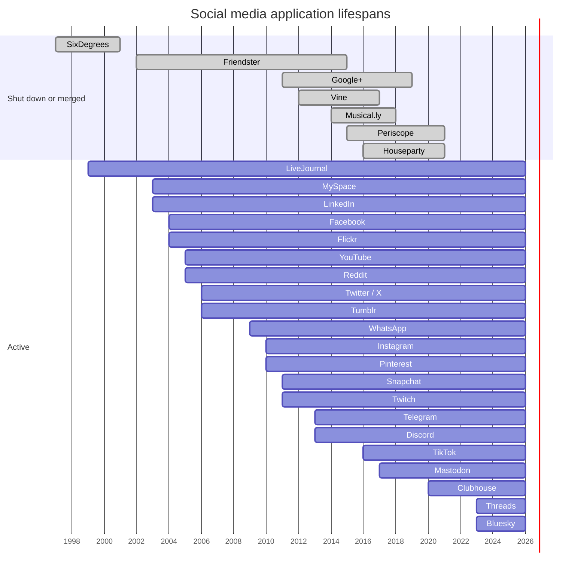

# Social Media Timeline

## Table of Contents

- [Timeline](#timeline)
- [Lifespan Gantt Chart](#lifespan-gantt-chart)

## Timeline

Approximate launch years and outcomes for notable social media applications. Categories overlap, and several services were acquired, rebranded or reshaped rather than cleanly shut down.

| Year | Application | Category                | What it introduced                                              | Outcome                                                                                     |
| ---- | ----------- | ----------------------- | --------------------------------------------------------------- | ------------------------------------------------------------------------------------------- |
| 1997 | SixDegrees  | Social network          | Profiles and friend lists tied to real identities               | Shut down in 2001 after failing to find a sustainable business                              |
| 1999 | LiveJournal | Blogging community      | Journals with friends lists and communities                     | Sold to SUP in 2007; declined as larger networks grew                                       |
| 2002 | Friendster  | Social network          | Friend-of-friend networking for mainstream users                | Lost users to scaling problems and MySpace; became a gaming site in 2011, shut down in 2015 |
| 2003 | MySpace     | Social network          | Customizable profiles, music pages and top friends              | Peaked mid-2000s; sold to News Corp in 2005; overtaken by Facebook around 2008              |
| 2003 | LinkedIn    | Professional network    | Resumes, connections and recruiting as a social graph           | Acquired by Microsoft in 2016; still active                                                 |
| 2004 | Facebook    | Social network          | Real-name profiles, News Feed (2006) and the Like button (2009) | Became the dominant network; parent renamed Meta in 2021                                    |
| 2004 | Flickr      | Photo sharing           | Tagging and community photo sharing                             | Sold to Yahoo in 2005, later to SmugMug in 2018; still active                               |
| 2005 | YouTube     | Video sharing           | Easy upload and embedding of user video                         | Acquired by Google in 2006; still active                                                    |
| 2005 | Reddit      | Forum aggregator        | Voted link and discussion communities                           | Still active; IPO in 2024                                                                   |
| 2006 | Twitter     | Microblogging           | 140-character public posts, later hashtags and retweets         | Acquired in 2022 and rebranded X in 2023                                                    |
| 2006 | Tumblr      | Microblogging           | Reblogging and low-friction multimedia blogs                    | Acquired by Yahoo in 2013, sold to Automattic in 2019                                       |
| 2009 | WhatsApp    | Messaging               | Phone-number-based mobile messaging                             | Acquired by Facebook in 2014; still active                                                  |
| 2010 | Instagram   | Photo sharing           | Mobile-first filtered photos in a square frame                  | Acquired by Facebook in 2012; added Stories (2016) and Reels (2020)                         |
| 2010 | Pinterest   | Visual discovery        | Pinboards for collecting images                                 | Public in 2019; still active                                                                |
| 2011 | Snapchat    | Ephemeral messaging     | Disappearing photos, then Stories (2013)                        | Declined Facebook's acquisition offer; public in 2017; Stories format copied widely         |
| 2011 | Google+     | Social network          | Circles for audience segmentation                               | Shut down for consumers in 2019                                                             |
| 2011 | Twitch      | Live streaming          | Live game broadcasts with chat                                  | Acquired by Amazon in 2014; still active                                                    |
| 2012 | Vine        | Short video             | Six-second looping videos                                       | Acquired by Twitter in 2012; shut down in 2017                                              |
| 2013 | Telegram    | Messaging               | Cloud-synced messaging with large groups and channels           | Still active                                                                                |
| 2013 | Discord     | Community chat          | Voice and text servers, first built for gamers                  | Broadened beyond gaming; still active                                                       |
| 2014 | Musical.ly  | Short video             | Lip-sync and music clips by teens                               | Acquired by ByteDance in 2017 and merged into TikTok in 2018                                |
| 2015 | Periscope   | Live streaming          | Mobile live broadcasts                                          | Acquired by Twitter before launch; shut down in 2021                                        |
| 2016 | TikTok      | Short video             | Algorithmic For You feed driven by interest rather than follows | Global growth after 2018; US ownership disputes followed                                    |
| 2016 | Houseparty  | Group video             | Drop-in group video calls                                       | Acquired by Epic Games in 2019; shut down in 2021                                           |
| 2017 | Mastodon    | Decentralized microblog | Federated servers speaking ActivityPub                          | Gained users after the 2022 Twitter acquisition                                             |
| 2020 | Clubhouse   | Audio rooms             | Invite-only live audio conversations                            | Spiked in early 2021 and faded as copies launched in other apps                             |
| 2023 | Threads     | Microblogging           | Instagram-linked text network launched as a Twitter alternative | Reached 100 million sign-ups within days; later added fediverse support                     |
| 2023 | Bluesky     | Decentralized microblog | Portable accounts on the AT Protocol                            | Opened to the public in 2024; grew after the 2024 US election                               |

## Lifespan Gantt Chart

Bars run from launch to shutdown or merger; active services run to the present. Bars for shut-down services are marked done.

