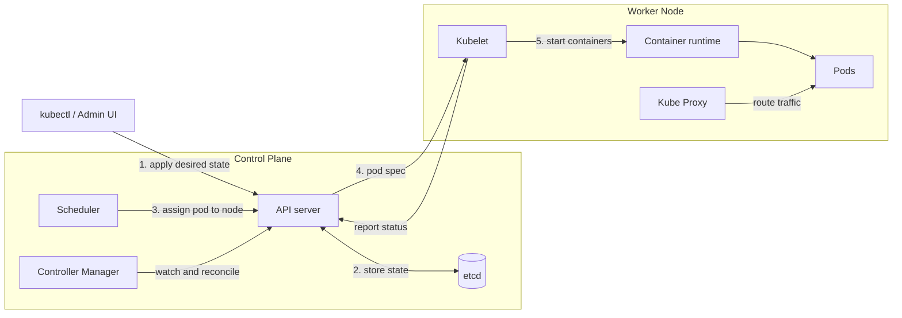

# Kubernetes (k8s)

- A Kubernetes cluster is a set of nodes used to automate running containerized applications, ie deployment, scaling, and management.

## Commands

```
brew install kubectl minikube
# kubectl - Kubernetes CLI client
# minikube - cluster

minikube start
minikube stop
minikube dashboard
minikube ssh
minikube delete

kubectl apply -f minikube.yaml
kubectl get all
kubectl get nodes
kubectl get pods
kubectl get pods -A
kubectl describe node
kubectl get svc

kubectl create deployment DEPLOYMENT_NAME --image=kicbase/echo-server:1.0
kubectl expose deployment DEPLOYMENT_NAME --type=NodePort --port=8080
minikube service SERVICE_NAME

# Delete
kubectl delete deployment DEPLOYMENT_NAME
kubectl delete service SERVICE_NAME
kubectl delete svc SERVICE_NAME
kubectl delete pod POD_NAME
kubectl delete -f minikube.yaml
```

## How It Works



1. You declare the desired state (e.g. 3 replicas) with `kubectl apply`.
2. The API server validates it and saves it in etcd.
3. The scheduler picks a node with enough resources for each unscheduled pod.
4. The kubelet on that node sees its assigned pods and tells the container runtime to start them.
5. Controllers and kubelets keep comparing actual to desired state and fix any drift, such as restarting a crashed pod.

## Components

**Admin UI and CLI** -> **Control Plane** <-> **Worker Nodes** > **Pods**

### Control Plane

- Responsible for managing the state of the cluster.
- **Core Components**
  - **API server** - Allows clients to interact with control plane to manage the cluster.
  - **etcd** - Distributed key, value store that stores the cluster's persistent state.
  - **Scheduler** - Schedules pods onto the worker nodes and makes placement decisions based on available resources
  - **Controller Manager** - Manages controllers that manage the stage of the cluster, ie ReplicationController, DeploymentController

### Worker Node

- runs containerized work loads
- core components
  - container runtime - Responsible for running containers on the worker nodes. Pulls containers from registry, start/stopping containiners, managing container resources.
  - **Kublet** - Used to communicate with _control plane_, ie receive instructions and ensure desired state of pods is maintained.
  - **Kube Proxy** - routes traffic to correct paths, load balances
  - **Pods** - The smallest deployable units of a k8s cluster. Pods host 1 or more containers and provides storage and network for the containers.

## Deploying

| Category         | Options                     |
| ---------------- | --------------------------- |
| Local            | minikube                    |
| Managed Services | AWS EKS, Azure AKS, GCP GKE |
