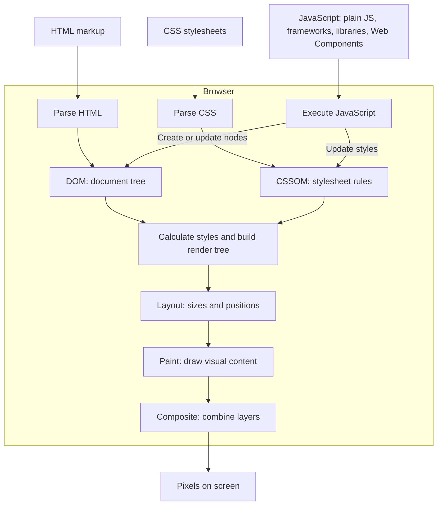

# Frontend Developer

## Table of Contents

- [Browser Rendering](#browser-rendering)
  - [Browser UI Approaches](#browser-ui-approaches)
  - [Embedding and Composition](#embedding-and-composition)
- [Styling and UI Components](#styling-and-ui-components)
  - [Styling Languages and Utilities](#styling-languages-and-utilities)
  - [UI Component Tools](#ui-component-tools)
  - [UI Component Names](#ui-component-names)
  - [Organizing Component Libraries](#organizing-component-libraries)
- [Tools](#tools)
  - [State Management](#state-management)
  - [Templating](#templating)
  - [Frameworks and Libraries](#frameworks-and-libraries)
  - [Angular vs React vs Vue](#angular-vs-react-vs-vue)
- [Mobile Development](#mobile-development)

## Browser Rendering

This is a simplified rendering flow. Native elements and custom elements are DOM nodes; optional Shadow DOM holds a custom element's internal nodes. Frameworks and libraries ultimately use browser APIs to update nodes or styles. Changes can trigger the affected rendering stages again; not every update requires layout or paint.

### Browser UI Approaches

These browser-level approaches can be combined with frameworks and libraries: a React app can render a Lit component containing native buttons. For comparisons of React, Vue, Svelte, Lit, and htmx, see [Web Frameworks and Libraries](../frameworks-and-libraries.md).

| Approach               | What It Is                                                           | Pros                                                                          | Cons                                                                                                                            | Best Used For                                                     |
| ---------------------- | -------------------------------------------------------------------- | ----------------------------------------------------------------------------- | ------------------------------------------------------------------------------------------------------------------------------- | ----------------------------------------------------------------- |
| Built-in HTML elements | Browser-provided tags such as `<button>`, `<input>`, and `<dialog>`. | No framework dependency; built-in semantics and behavior.                     | Limited to the controls the browser provides; application behavior still needs code.                                            | Foundation for almost every website.                              |
| Native Web Components  | Custom browser elements, optionally using Shadow DOM.                | Reusable across frameworks; optional isolation of internal markup and styles. | Manual rendering and state updates without a helper library; styling, forms, accessibility, and server rendering need planning. | Embeddable widgets and components shared across different stacks. |
| Plain JavaScript + DOM | Directly create elements, attach listeners, and update the DOM.      | Full control; little setup; no framework required.                            | You manage state, updates, and listener cleanup yourself; complexity grows with the UI.                                         | Small widgets and simple interactions.                            |

Native Web Components use built-in browser APIs rather than an installed library or framework.

### Embedding and Composition

Ways to bring content that lives elsewhere into a page. They trade isolation against integration, so choose by how much you trust the content: untrusted third-party content belongs in an iframe or fenced frame, while content from your own teams usually fits Shadow DOM, Module Federation, or fragment swaps. Shadow DOM is covered under [Browser UI Approaches](#browser-ui-approaches).

| Approach                        | What It Is                                                                  | Isolation                                           | Integration                                                      |
| ------------------------------- | --------------------------------------------------------------------------- | --------------------------------------------------- | ---------------------------------------------------------------- |
| `<embed>` / `<object>`          | Older elements for plugins, PDFs, SVG, and other media.                     | Moderate, depending on content type.                | Weak; largely superseded by iframes and native elements.         |
| Fenced frames                   | A privacy-focused iframe with no communication channel to the embedder.     | Very strong, deliberately one-way.                  | Minimal; used for ads and Privacy Sandbox.                       |
| Fragment swaps (htmx, `fetch`)  | The client fetches an HTML fragment and swaps it into the page.             | None.                                               | Highest, but you must trust the fragment.                        |
| [`<iframe>`](./iframe.md)       | A separate document nested in the page, optionally restricted by `sandbox`. | Strongest: own DOM, JS, CSS, and origin.            | Weakest: fixed sizing; messages go through `postMessage`.        |
| Micro-frontends                 | Separately deployed apps composed into one shell.                           | Varies: iframes strongest, Module Federation none.  | Varies with technique; iframes need extra routing and auth work. |
| Server-side or edge composition | Server, CDN, or ESI stitches HTML fragments before sending.                 | None in the browser.                                | High: the browser sees a single page.                            |
| Shadow DOM                      | Encapsulated DOM and styles inside the same document.                       | Style and DOM only; shares the JS realm and origin. | High: same page, events bubble, themable with CSS variables.     |
| Third-party script tags         | A `<script>` that injects its own widget, as with analytics and chat.       | None: runs with full page privileges.               | High, with the highest security risk.                            |

## Styling and UI Components

### Styling Languages and Utilities

| Technology      | Description                                                                                                              | Pros                                                                    | Cons                                                                                                        | Best Used For                                                                            |
| --------------- | ------------------------------------------------------------------------------------------------------------------------ | ----------------------------------------------------------------------- | ----------------------------------------------------------------------------------------------------------- | ---------------------------------------------------------------------------------------- |
| [CSS](./css.md) | Browser-native styling language for layout, colors, fonts, and responsive presentation.                                  | Full styling control; no compilation required; works with any UI stack. | You organize styles and reusable patterns yourself; cascade and specificity can become difficult to manage. | Styling any website, especially when direct control and minimal tooling matter.          |
| SCSS            | A Sass syntax extending CSS with variables, nesting, mixins, functions, and other authoring features; compiled into CSS. | Reuses style logic and organizes complex stylesheets.                   | Requires compilation; excessive nesting and abstractions can complicate generated CSS.                      | Stylesheets that benefit from shared mixins, functions, and build-time style generation. |
| Tailwind CSS    | CSS framework using utility classes such as `p-4` to compose styles in markup.                                           | Fast composition; shared design tokens; responsive and state variants.  | Class-heavy markup; requires CSS generation tooling; provides no interactive component behavior by itself.  | Custom interfaces and component systems that benefit from styling directly in markup.    |

### UI Component Tools

| Technology                  | Description                                                                                                                 | Pros                                                                              | Cons                                                                                               | Best Used For                                                                               |
| --------------------------- | --------------------------------------------------------------------------------------------------------------------------- | --------------------------------------------------------------------------------- | -------------------------------------------------------------------------------------------------- | ------------------------------------------------------------------------------------------- |
| [Bootstrap](./bootstrap.md) | CSS framework with styled components, a responsive grid, and JavaScript plugins for interactions.                           | Ready-made controls and consistent defaults speed up development.                 | Distinctive designs require customization; unused styles and scripts can add weight.               | Prototypes, internal tools, and sites that fit conventional component layouts.              |
| Radix UI                    | Unstyled React primitives providing interaction behavior and accessibility features for controls such as dialogs and menus. | Handles many keyboard, focus, and ARIA patterns; flexible styling.                | Requires React and your own styling; composition still needs accessibility checks.                 | Custom React design systems needing reusable interaction primitives.                        |
| shadcn/ui                   | Styled component source code distributed into your project for direct customization.                                        | Useful defaults; editable source; control over component behavior and appearance. | You maintain copied code and reconcile upstream changes; dependencies and setup vary by component. | Applications needing ready-made components that can be adapted into a custom design system. |

### UI Component Names

| Component      | What It Is                                                                | Typical Use                                   |
| -------------- | ------------------------------------------------------------------------- | --------------------------------------------- |
| Accordion      | Stacked headers that each expand or collapse their own content panel.     | FAQs, settings groups.                        |
| Alert          | Inline banner that communicates a status or message within the page flow. | Form errors, warnings, info notes.            |
| Alert dialog   | Modal that interrupts to demand a confirm or cancel decision.             | Delete confirmation.                          |
| Avatar         | Small image or initials representing a user or entity.                    | Profile menus, comment threads.               |
| Badge          | Small label or count attached to another element.                         | Unread counts, status tags.                   |
| Breadcrumb     | Trail of links showing the current page's place in a hierarchy.           | Deep navigation, file paths.                  |
| Card           | Bordered container grouping related content and actions.                  | Product tiles, dashboard widgets.             |
| Carousel       | Horizontally sliding set of items shown one or a few at a time.           | Image galleries, featured content.            |
| Checkbox       | Control toggling an option on or off; several can be selected.            | Multi-select options, consent.                |
| Combobox       | Text input paired with a filterable dropdown list of options.             | Searchable selects, autocomplete.             |
| Dialog / Modal | Overlay window that blocks the page behind it until closed.               | Forms, confirmations, detail views.           |
| Drawer / Sheet | Panel that slides in from a screen edge over or beside the page.          | Mobile menus, filters, detail panes.          |
| Dropdown menu  | List of actions revealed from a trigger button.                           | Overflow (`...`) menus, user menus.           |
| Pagination     | Controls for moving between pages of a long list.                         | Search results, tables.                       |
| Popover        | Floating panel anchored to a trigger, closed by clicking away.            | Date pickers, small forms.                    |
| Progress bar   | Bar showing how much of a task is complete.                               | Uploads, multi-step flows.                    |
| Radio group    | Set of options where exactly one can be selected.                         | Plan or size selection.                       |
| Select         | Control choosing one option from a collapsed list.                        | Country or language pickers.                  |
| Skeleton       | Grey placeholder shaped like content while it loads.                      | Loading lists and cards without layout shift. |
| Slider         | Draggable handle selecting a value or range along a track.                | Volume, price range.                          |
| Snackbar       | Material Design name for a toast, often with one action.                  | "Undo" after a delete.                        |
| Spinner        | Rotating indicator for an operation of unknown duration.                  | Button or page loading.                       |
| Stepper        | Indicator or flow showing progress through ordered steps.                 | Checkout, onboarding.                         |
| Switch         | Control toggling a setting on or off immediately.                         | Dark mode, notifications.                     |
| Table          | Rows and columns of structured data, often sortable.                      | Admin lists, reports.                         |
| Tabs           | Row of headers that swap which content panel is visible.                  | Settings sections, views of one record.       |
| Toast          | Brief, non-blocking message that appears and auto-dismisses.              | "Saved" confirmations.                        |
| Tooltip        | Small text bubble shown on hover or focus to explain an element.          | Icon button labels.                           |

### Organizing Component Libraries

Ways to structure UI components in a codebase, independent of the tools above. They combine: a shared package can use Atomic Design internally while the app around it is organized by feature.

| Approach                      | What It Is                                                                                                               | Pros                                                                                         | Cons                                                                                                          | Best Used For                                                                  |
| ----------------------------- | ------------------------------------------------------------------------------------------------------------------------ | -------------------------------------------------------------------------------------------- | ------------------------------------------------------------------------------------------------------------- | ------------------------------------------------------------------------------ |
| Atomic Design                 | Components grouped by composition level: atoms (button), molecules (search field), organisms (header), templates, pages. | Shared vocabulary; encourages small reusable parts; clear build-up from primitives to pages. | Levels are subjective (is it a molecule or an organism?); deep folders; feature code gets scattered by level. | Design systems and component libraries with a broad, reusable UI kit.          |
| Copy-in components            | Component source copied into your repo (such as shadcn/ui) and edited directly.                                          | Full ownership and customization; no library version lock.                                   | You maintain the copied code and merge upstream changes by hand.                                              | Apps that want ready-made starting points but a fully custom final design.     |
| Design system package         | A separately versioned library of tokens and components consumed by one or more apps, often with Storybook docs.         | One source of truth; consistent look across apps; isolated testing and documentation.        | Versioning and release overhead; slows one-off changes; needs ownership and governance.                       | Multiple apps or teams that must share the same look and behavior.             |
| Feature or domain folders     | Components colocated with the feature that uses them (`checkout/`, `profile/`); only truly shared parts are promoted.    | Related code changes together; easy ownership and deletion; no premature abstraction.        | Duplication can creep in; promoting to shared needs discipline.                                               | Product applications with distinct features and several contributors.          |
| Flat or type-based folders    | A single `components/` folder, or folders by kind (`buttons/`, `forms/`, `layouts/`).                                    | Zero ceremony; everything is easy to find at small scale.                                    | Becomes a dumping ground as it grows; no signal of what is shared versus feature-specific.                    | Small apps, prototypes, and early-stage projects.                              |
| Headless primitives + styling | Unstyled behavior and accessibility primitives (such as Radix UI) wrapped in your own styled components.                 | Accessibility handled; full visual control; swappable styling layer.                         | You build and maintain the styled layer; requires a design direction up front.                                | Custom design systems that need accessible behavior without a prescribed look. |
| Third-party component library | An installed package of finished components (Bootstrap, MUI, Ant Design) used as-is with theming.                        | Fastest to start; consistent, tested components; upstream fixes arrive with upgrades.        | Distinct branding needs overrides; bundle weight; coupled to the library's roadmap and conventions.           | Internal tools, admin dashboards, and MVPs where speed beats a unique look.    |

## Tools

### State Management

- [Redux](./redux.md)

### Templating

- [Jinja](./jinja.md)

### Frameworks and Libraries

- [Web Frameworks and Libraries](../frameworks-and-libraries.md)

### Angular vs React vs Vue

| Task                         | Angular                                                 | React                                               | Vue 3                                                |
| ---------------------------- | ------------------------------------------------------- | --------------------------------------------------- | ---------------------------------------------------- |
| Component definition         | Class with `@Component` decorator                       | Function returning JSX                              | Single-file component (`.vue`) with `<script setup>` |
| Local state                  | `signal()`                                              | `useState`                                          | `ref()` / `reactive()`                               |
| Derived state                | `computed()`                                            | `useMemo` (or compute inline)                       | `computed()`                                         |
| Side effects                 | `effect()`, lifecycle hooks (`ngOnInit`, `ngOnDestroy`) | `useEffect`                                         | `watch` / `watchEffect`, `onMounted` / `onUnmounted` |
| Props / inputs               | `input()` signal (or `@Input()`)                        | Function arguments (props object)                   | `defineProps()`                                      |
| Events / outputs             | `output()` (or `@Output()` with `EventEmitter`)         | Callback props                                      | `defineEmits()`                                      |
| Two-way binding              | `[(ngModel)]` or `model()`                              | Controlled input (`value` + `onChange`)             | `v-model`                                            |
| Conditionals                 | `@if` / `@else`                                         | `{cond && <X/>}`, ternary                           | `v-if` / `v-else`                                    |
| Loops                        | `@for (item of items; track item.id)`                   | `items.map(...)` with `key`                         | `v-for` with `:key`                                  |
| Event binding                | `(click)="handler()"`                                   | `onClick={handler}`                                 | `@click="handler"`                                   |
| Attribute / property binding | `[prop]="value"`                                        | `prop={value}`                                      | `:prop="value"`                                      |
| Content projection           | `<ng-content>`                                          | `children` prop                                     | `<slot>`                                             |
| Shared logic                 | Services and `inject()`; plain functions                | Custom hooks                                        | Composables                                          |
| Dependency injection         | Built-in hierarchical DI (`inject()`, `providedIn`)     | Context (`createContext` / `useContext`)            | `provide` / `inject`                                 |
| Global state                 | Services with signals; NgRx for large apps              | Context, Redux Toolkit, or Zustand                  | Pinia                                                |
| Routing                      | `@angular/router` (official, built in)                  | React Router, or the router in Next.js              | Vue Router (official)                                |
| HTTP / data fetching         | `HttpClient` (RxJS or signals); interceptors            | `fetch` / axios; TanStack Query                     | `fetch` / axios; TanStack Query                      |
| Forms                        | Reactive Forms or Template-driven Forms (built in)      | React Hook Form or Formik; controlled inputs        | `v-model` plus VeeValidate or FormKit                |
| Async streams                | RxJS (core to the framework)                            | Not built in; usually promises and hooks            | Not built in; usually promises and composables       |
| Change detection             | Zone.js (or zoneless with signals)                      | Virtual DOM re-render, with `memo` for optimization | Fine-grained reactivity via proxies                  |
| Meta-framework / SSR         | Angular SSR (built in)                                  | Next.js, Remix / React Router                       | Nuxt                                                 |

## Mobile Development

- [Mobile Development](./mobile-development/mobile-development.md)
